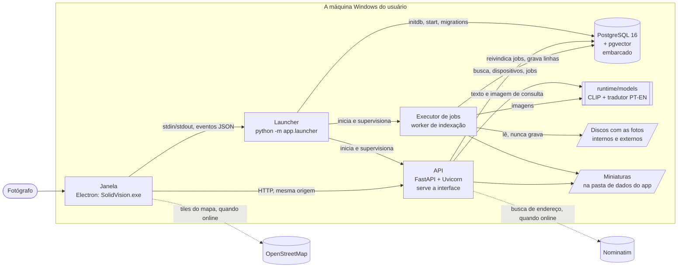
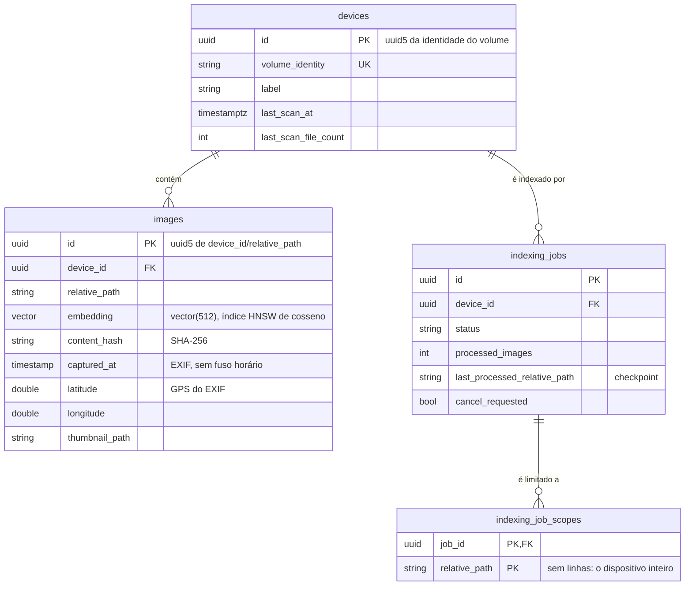

# Arquitetura do SolidVision

**Versão:** 1.1  
**Status:** Descreve o sistema implementado, até o RFC-046  
**Última atualização:** novembro de 2026

> **Como ler este documento.** Ele foi escrito em julho de 2026 como o projeto, antes de qualquer código, e cresceu junto com os RFCs. Desde outubro de 2026 descreve o que foi construído. Onde o projeto e o sistema divergem, a seção diz isso e nomeia o RFC que decidiu; o que foi projetado e nunca construído está marcado *(não construído)*. Os registros de decisão estão em [docs/adr](docs/adr/README.md), e cada mudança, com suas medições, em [docs/rfcs](docs/rfcs/README.md).

---

# 1. Visão geral do projeto

O SolidVision é um sistema de recuperação semântica de imagens com IA, feito para ajudar fotógrafos profissionais a gerenciar com eficiência grandes acervos locais de imagens. O projeto nasceu para resolver um problema comum dos fotógrafos aéreos: localizar fotografias específicas entre centenas de milhares de imagens guardadas ao longo de muitos anos.

Ao contrário dos exploradores de arquivos tradicionais, que dependem da estrutura de pastas ou de nomes de arquivos dados à mão, o SolidVision permite pesquisar o acervo em linguagem natural. O usuário descreve a imagem desejada (por exemplo, *"propriedade rural com lago"*), e o sistema devolve as fotografias semanticamente mais parecidas.

O sistema funciona inteiramente no armazenamento local. As imagens nunca são enviadas para servidores externos, o que preserva a privacidade do usuário e minimiza o custo de armazenamento. Em vez disso, o SolidVision indexa pastas locais, extrai embeddings semânticos com um modelo de IA multimodal e guarda apenas metadados e representações vetoriais em um banco PostgreSQL.

A arquitetura foi projetada pensando na manutenção a longo prazo, de modo que os modelos de IA, o banco de dados ou a interface possam ser trocados no futuro com impacto mínimo no resto do sistema.

---

# 2. Objetivos arquiteturais

A arquitetura do SolidVision foi projetada em torno dos seguintes objetivos:

## Manutenibilidade

As regras de negócio devem permanecer independentes de frameworks, bancos de dados e bibliotecas de IA.

## Escalabilidade

O sistema deve suportar acervos com pelo menos **100.000 imagens indexadas** mantendo a busca semântica rápida.

## Extensibilidade

O modelo de embedding deve poder ser substituído sem afetar a lógica de negócio.

Exemplos:

- CLIP LAION ViT-B/32: o modelo atual (RFC-023)
- SigLIP: a escolha original, medida e substituída (ADR-001)
- Checkpoints do OpenCLIP, ou modelos adaptados a imagens aéreas (RFC-042, proposto)

A substituição já aconteceu uma vez, do SigLIP para o CLIP, e não mudou nenhuma
linha do Domain nem da Application (RFC-023, seção 5).

## Testabilidade

A lógica de negócio central deve ser totalmente testável sem exigir:

- PostgreSQL
- PyTorch
- HuggingFace
- FastAPI

## Separação de responsabilidades

Cada camada tem uma única responsabilidade.

A Presentation trata o HTTP.

A Application orquestra os casos de uso.

O Domain contém as regras de negócio.

A Infrastructure se comunica com os sistemas externos.

## Local primeiro (local-first)

O SolidVision nunca duplica arquivos de imagem.

O sistema de arquivos é considerado a única fonte de verdade.

Apenas metadados, miniaturas e embeddings são guardados no banco de dados.

---

# 3. Princípios fundamentais

O SolidVision segue os seguintes princípios arquiteturais.

- Clean Architecture
- SOLID
- Repository Pattern
- Injeção de dependência
- Separação de responsabilidades
- Alta coesão
- Baixo acoplamento
- Dependências explícitas
- Composição em vez de herança
- Domain-Driven Design (onde fizer sentido)

A lógica de negócio deve permanecer independente de frameworks.

Nenhum código específico de framework deve existir dentro da camada Domain.

---

# 4. Stack tecnológica

## Backend

- Python 3.12
- FastAPI e Uvicorn
- SQLAlchemy 2 e psycopg 3
- Alembic
- PostgreSQL 16 com pgvector 0.8.6
- Pillow
- Pydantic e pydantic-settings

## Inteligência artificial

Modelo padrão

- CLIP `laion/CLIP-ViT-B-32-laion2B-s34B-b79K`, 512 dimensões, via
  `transformers` e PyTorch, na CPU (RFC-023)
- As consultas em português são traduzidas para o inglês antes:
  `Helsinki-NLP/opus-mt-ROMANCE-en` (MarianMT), com o `langdetect` decidindo
  o que traduzir
- Os dois modelos são fixados por revisão e `sha256`, e carregados de
  `runtime/models` sem rede (RFC-035)

Adaptadores futuros, atrás da mesma porta

- Checkpoints adaptados a imagens aéreas, ou um CLIP com fine-tuning (RFC-042, proposto)
- OpenCLIP, SigLIP ou outros: um adaptador novo e uma reindexação completa

## Frontend

- Electron 44: a janela, que inicia o launcher (RFC-037)
- React 19, TypeScript e Vite
- TanStack Query e React Router
- Leaflet, para o mapa (RFC-040)
- CSS Modules sobre design tokens tirados do mockup do Figma; nenhum framework de CSS
- Tipos gerados a partir do schema OpenAPI da API (`openapi-typescript`),
  conferidos contra divergências pelas duas suítes de teste

## Infraestrutura

- PostgreSQL embarcado no instalador, iniciado pelo app como processo filho
  (ADR-008, RFC-033)
- O launcher, que inicia e supervisiona o cluster, a API e o executor de
  jobs (RFC-036)
- O instalador: a distribuição *embeddable* do Python 3.12, electron-builder
  e NSIS, por usuário e sem elevação (RFC-041)
- Docker Compose, só para desenvolvimento

## Testes

- pytest, com os marcadores opcionais (opt-in) `slow` (os modelos reais) e
  `embedded` (servidores PostgreSQL reais)
- Vitest
- Ruff, Black e `mypy --strict`; ESLint e Prettier

---

## Registro de decisão de arquitetura — ADR-001

> **Substituído pelo RFC-023** (agosto de 2026). Uma comparação de quatro
> checkpoints no corpus de demonstração escolheu o **CLIP LAION ViT-B/32, 512
> dimensões**: tão preciso quanto o SigLIP base nesse corpus (60,0% de top-1
> estrito em inglês, com o template `a photo of {query}`), e cerca de dez vezes
> mais rápido para indexar na CPU (0,46 a 0,70 s por imagem, contra ~4,96 s). A
> coluna passou de `vector(1152)` para `vector(512)` e tudo foi reindexado, o
> custo que o ADR-007 já tinha previsto. A decisão original segue como foi
> escrita ([ADR-001](docs/adr/adr-001-modelo-de-embedding.md)).

### Decisão

Usar o **SigLIP** como modelo de embedding padrão.

### Justificativa

O SigLIP oferece um alinhamento semântico entre imagens e linguagem natural mais forte que a arquitetura CLIP original, especialmente em tarefas de recuperação zero-shot.

Sua integração com o ecossistema HuggingFace também simplifica a implantação e a experimentação futura.

### Trade-offs

- Inferência um pouco mais lenta que a do CLIP
- Maior consumo de memória ao gerar os embeddings
- Exige reindexação completa se for substituído por outro modelo de embedding

---

# 5. Arquitetura de alto nível

O SolidVision segue os princípios da Clean Architecture.

```text
                ┌──────────────────────┐
                │     Presentation     │
                │      (FastAPI)       │
                └──────────┬───────────┘
                           │
                           ▼
                ┌──────────────────────┐
                │     Application      │
                │    (Casos de uso)    │
                └──────────┬───────────┘
                           │
                           ▼
                ┌──────────────────────┐
                │        Domain        │
                │ Só regras de negócio │
                └──────────────────────┘
                           ▲
                           │
                ┌──────────┴───────────┐
                │    Infrastructure    │
                │  IA • BD • Arquivos  │
                └──────────────────────┘
```

As dependências sempre apontam para o Domain.

A Infrastructure implementa interfaces definidas pelas camadas Domain e Application.

O Domain nunca importa bibliotecas ou frameworks externos.

## Processos em tempo de execução

As camadas acima são o código. Em tempo de execução, o app instalado são cinco
tipos de processo em uma só máquina, e nada escuta além de `127.0.0.1`
(RFC-036, RFC-037, RFC-041):



A janela inicia o launcher com pipes e lê os seus eventos; fechar a janela
fecha o stdin do launcher, o que para os processos filhos e o cluster em
ordem. A API serve a interface compilada a partir de `frontend/` na mesma
origem de `/api/v1`, então não há CORS, e confere `Host` e `Origin` contra DNS
rebinding (RFC-037). Um job é uma linha: a API a grava, e o executor de jobs a
reivindica, indexa e informa o progresso na mesma linha (RFC-029). O único
tráfego que sai da máquina é opcional e visível: os tiles do mapa e a busca de
endereço, cada um com o User-Agent do projeto (RFC-040, RFC-043).

---

# 6. Responsabilidades das camadas

## Presentation

Responsável por:

- Endpoints HTTP
- Validação das requisições
- Serialização das respostas
- Autenticação (futuro)
- Injeção de dependência

A Presentation nunca deve conter regras de negócio.

---

## Application

Contém os casos de uso do sistema.

Como construído (um caso de uso por arquivo, em `application/use_cases/`):

- Indexar ou atualizar as imagens de um dispositivo, de forma incremental (`IndexOrUpdateImagesUseCase`)
- Buscar por texto, por uma foto já indexada ou por uma enviada (`SearchImagesUseCase`, `FindSimilarImagesUseCase`)
- Percorrer as fotos de um lugar por data, sem consulta textual (`BrowseImagesUseCase`)
- Contar as fotos por célula do mapa (`AggregatePositionsUseCase`)
- Registrar e renomear dispositivos, listar os volumes montados e as pastas de um dispositivo (`RegisterDeviceUseCase`, `RenameDeviceUseCase`, `ListMountedVolumesUseCase`, `ListDeviceFoldersUseCase`)
- Criar, acompanhar e cancelar jobs de indexação (`CreateIndexingJobUseCase`, `GetIndexingJobUseCase`, `CancelIndexingJobUseCase`)
- Servir uma miniatura, descrever uma foto, mostrá-la no Explorer (`GetThumbnailUseCase`, `GetImageDetailsUseCase`, `RevealImageUseCase`)
- Transformar um endereço em um lugar (`GeocodeAddressUseCase`)

Os exemplos originais eram casos de uso de coleção (criar, excluir, atualizar,
indexar uma coleção). Nenhum foi construído: o sistema indexa dispositivos e as
pastas neles, e `Collection` é uma entidade provisória (placeholder) (RFC-027).

A camada Application orquestra os fluxos, mas não implementa detalhes de infraestrutura.

---

## Domain

O Domain contém apenas conceitos de negócio.

Ele deve permanecer Python puro.

Contém:

- Entidades
- Value Objects
- Interfaces de repositório
- Serviços de domínio

O Domain não sabe nada sobre:

- FastAPI
- SQLAlchemy
- PostgreSQL
- Torch
- Transformers
- Pillow

---

## Infrastructure

A Infrastructure contém as implementações concretas.

Exemplos:

- Repositórios PostgreSQL, e o adaptador do cluster embarcado
- O adaptador do CLIP (`ClipEmbeddingModel`) e o tradutor PT→EN (`QueryTranslator`)
- Varredura de arquivos e identidade de volume (GUIDs de volume do Windows)
- Gerador de miniaturas
- Extrator de metadados: data de captura e posição GPS do EXIF
- O worker de indexação e o executor de jobs
- O geocodificador Nominatim

A Infrastructure implementa interfaces definidas pelas camadas superiores.

---

# 7. Regras de dependência

A direção das dependências segue o Princípio da Inversão de Dependência.

Relações permitidas:

```text
Presentation
        │
        ▼
Application
        │
        ▼
Domain
```

A Infrastructure **não** é dona da lógica de negócio.

Em vez disso, ela fornece implementações para interfaces definidas pelas camadas Application e Domain.

Exemplo:

```text
Application
        │
        ▼
EmbeddingModelPort
        ▲
        │ implementa
Infrastructure
        │
        ▼
ClipEmbeddingModel
```

A camada Domain nunca deve depender de:

- FastAPI
- SQLAlchemy
- PostgreSQL
- Torch
- Transformers
- Pillow

A camada Application nunca deve instanciar diretamente componentes de infraestrutura.

A injeção de dependência deve sempre fornecer as implementações concretas.

---

# 8. Estrutura de pastas

```text
solidvision/

├── backend/
│   ├── app/
│   │   ├── presentation/      FastAPI: /health, /api/v1, a interface
│   │   ├── application/       casos de uso
│   │   ├── domain/            entidades, value objects, portas
│   │   ├── infrastructure/    IA, persistência, PostgreSQL embarcado, sistema de arquivos, workers
│   │   ├── launcher/          inicia e supervisiona tudo (RFC-036)
│   │   └── cli/               index, search, search-image
│   ├── tests/                 espelha app/; marcadores `slow` e `embedded`
│   ├── alembic/               migrations
│   ├── dataset/demo/          45 imagens, manifesto, 25 consultas em EN e PT
│   └── dataset_tools/
│
├── frontend/
│   ├── electron/              o processo principal da janela
│   ├── src/                   a interface: React, por tela
│   └── scripts/               dev, build, instalador (dist)
│
├── docs/
│   ├── adr/                   registros de decisão de arquitetura
│   └── rfcs/                  um RFC por mudança, com suas medições
│
├── experiments/               um script de medição por RFC; os logs ficam fora do git
├── scripts/                   vendoring dos três runtimes, lockfiles, verificações do pacote
├── runtime/                   python, postgres, models: materializados a partir dos lockfiles, fora do git
├── docker/                    o init do banco de desenvolvimento
│
├── README.md
├── ARCHITECTURE.md
├── THIRD-PARTY-NOTICES.md
└── docker-compose.yml         só para desenvolvimento
```

Cada camada deve permanecer independente e ter uma responsabilidade claramente definida.

---

# 9. Abstração da IA

A Inteligência Artificial é tratada como uma questão de infraestrutura.

As regras de negócio nunca se comunicam diretamente com o CLIP nem com qualquer outro modelo.

Em vez disso, toda a interação acontece por meio de portas (Ports).

```text
Application

↓

EmbeddingModelPort

↑

ClipEmbeddingModel     produção: CLIP, com o tradutor PT→EN

FakeEmbeddingModel     testes: vetores determinísticos, sem IA

FutureAdapter
```

Trocar o modelo de embedding deve exigir mudanças apenas na camada Infrastructure.

Nenhum código da Application ou do Domain deve ser modificado ao introduzir um novo modelo de IA.

---

# 10. EmbeddingModelPort

A interface do modelo de embedding define o contrato entre a camada Application e as implementações de IA.

Os embeddings de imagem e de texto devem ser gerados pela mesma família de modelos, para garantir que os vetores ocupem o mesmo espaço semântico.

A interface como construída (`domain/services/embedding_model_port.py`):

```python
class EmbeddingModelPort(ABC):

    @abstractmethod
    def encode_image(self, image: Image) -> EmbeddingVector: ...

    @abstractmethod
    def encode_text(self, text: str) -> EmbeddingVector: ...

    def encode_images(self, images: Sequence[Image]) -> list[EmbeddingVector]:
        """Um lote; por padrão, uma imagem por vez (RFC-024)."""

    def warm_up(self) -> None:
        """Carrega o modelo agora, e não na primeira chamada (RFC-029)."""
```

Qualquer modelo de embedding futuro deve implementar esta interface.

---

# 11. Estratégia de versionamento

Vetores de embedding gerados por modelos diferentes **não são compatíveis**.

Por isso, o modelo que produziu os vetores guardados precisa ser conhecido e fixo.

O projeto pedia que cada embedding carregasse os seus metadados:

- model_name
- model_version
- embedding_dimension
- created_at

**Como construído** (ADR-005, parcialmente implementado): a dimensão é a da
coluna, `vector(512)`, verificada em tempo de execução; o modelo é o que
`backend/app/infrastructure/ai/models.lock.json` fixa, por revisão e `sha256`
(RFC-035). `model_name` e `model_version` não são guardados por linha nem por
coleção, porque `Collections` nunca foi construída. Uma troca por outro modelo
de 512 dimensões seguida de uma reindexação parcial passaria, portanto,
despercebida, e é por isso que trocar o modelo é um RFC, nunca uma
configuração.

Exemplo:

```text
Imagem

↓

Embedding

↓

Modelo: laion/CLIP-ViT-B-32-laion2B-s34B-b79K (revisão 1a25a446)

↓

Dimensão: 512
```

O banco de dados deve conter apenas embeddings gerados por uma única versão de modelo.

Quando o modelo de embedding muda, todos os discos precisam ser reindexados.

Versões futuras podem suportar várias coleções usando modelos de embedding diferentes ao mesmo tempo.

---

# 12. Arquitetura do worker

A indexação de imagens é executada por um worker dedicado, e não diretamente dentro dos endpoints do FastAPI.

O worker é responsável pelas tarefas de longa duração e pode ser executado por uma interface de linha de comando.

Responsabilidades:

- Varrer pastas
- Detectar imagens novas
- Extrair metadados
- Gerar miniaturas
- Gerar embeddings
- Persistir os dados

**Como construído** (RFC-029): um pedido de indexação é uma linha em
`indexing_jobs`, gravada por `POST /api/v1/jobs`. O executor de jobs
(`python -m app.infrastructure.workers.job_runner`), iniciado e supervisionado
pelo launcher, consulta a tabela periodicamente, reivindica um job por vez e o
executa com heartbeat, checkpoint retomável e cancelamento cooperativo. A CLI
(`python -m app.cli index`) cria um job e o executa no próprio processo. Antes
de começar a consultar, o executor aquece o modelo, para que um job reivindicado
nunca fique parado em silêncio enquanto o modelo carrega.

Versões futuras podem substituir o executor de jobs pelo Celery ou por outra fila de tarefas distribuída sem afetar a lógica de negócio.

---

# 13. Pipeline de indexação

O processo de indexação segue um pipeline determinístico.

```text
Sistema de arquivos

↓

Varredura de pastas

↓

Extração de metadados

↓

Geração de miniaturas

↓

Pré-processamento da imagem

↓

Encoder de imagem do CLIP (em lotes, RFC-024)

↓

Vetor de embedding

↓

PostgreSQL + pgvector
```

Cada imagem é processada uma única vez por versão do modelo.

A indexação é incremental: um arquivo sem mudança é pulado pelo tamanho e pela
data de modificação, e um hash do conteúdo confirma a mudança antes que qualquer
embedding seja gerado de novo (RFC-020, RFC-024; ver "Indexação incremental"
abaixo). Vazão medida na CPU: 1,0 a 2,2 imagens por segundo, conforme a máquina
(RFC-024, RFC-025 seção 11.6, RFC-035).

---

# 14. Pipeline de busca

O pipeline de busca semântica espelha o de indexação.

```text
Consulta do usuário

↓

Detecção de idioma; o português é traduzido para o inglês (MarianMT)

↓

Prompt: "a photo of {query}"

↓

Encoder de texto do CLIP

↓

Embedding do texto

↓

Busca vetorial (pgvector)

↓

Similaridade de cosseno

↓

Ranking

↓

Top-K resultados

↓

Frontend
```

Como imagens e textos são projetados no mesmo espaço vetorial semântico, os usuários podem pesquisar o acervo em linguagem natural sem etiquetar as imagens à mão.

O processo de busca nunca recarrega nem reprocessa os arquivos de imagem originais.

## Filtros

O ranking pode ser restringido por três eixos nomeados, guardados em
`SearchFilters`, cada um com a sua própria cláusula `WHERE`, os seus próprios
parâmetros de consulta e — onde pode esconder fotos por falta de dados — a sua
própria contagem do que excluiu:

| Eixo | Parâmetros | Cláusula | Contagem de excluídas |
|------|------------|----------|-----------------------|
| Dispositivo (RFC-027) | `device_id` (repetível) | `device_id IN (...)` | — |
| Data de captura (RFC-028) | `captured_from`, `captured_to` | intervalo semiaberto em `captured_at` | `excluded_unknown_date` |
| Posição (RFC-032) | `near_lat`, `near_lon`, `radius_m` (todos ou nenhum) | pré-filtro por retângulo envolvente + distância exata de haversine | `excluded_unknown_position` |

Os eixos se combinam com AND. Um `SearchFilters()` vazio emite a consulta do
RFC-025 sem nenhuma mudança, caractere por caractere. Uma imagem cuja data ou
posição é desconhecida nunca passa no filtro desse eixo, por mais amplo que
seja. O filtro de posição é um **círculo**, nunca um ponto: o usuário conhece
um lugar no mapa, não coordenadas, e o GPS registrou a aeronave e não o que foi
fotografado, então o raio — em metros em todo lugar, com um mínimo configurado
(`MIN_RADIUS_M`) — faz parte da pergunta. A distância é uma expressão de
haversine sobre duas colunas comuns; sem PostGIS, sem `earthdistance`.

Qualquer filtro pode devolver menos que `limit` resultados quando o PostgreSQL
usa o índice aproximado HNSW e pós-filtra os seus candidatos. Para um círculo
sobre posições agrupadas, isso foi medido com 20% de seletividade: 13 de 20
consultas voltaram incompletas (RFC-032, seção 6.1). Todas as mitigações de
HNSW medidas resolveram o problema, mas nenhuma atendeu ao critério de latência
que o RFC-032 declarou, então nenhuma foi aplicada; o contrato de
`search_similar()` continua permitindo um resultado incompleto.

Isso só acontece onde o planejador usa o índice, como no PostgreSQL 17 em que
a medição rodou. No PostgreSQL 16 embarcado do app instalado, a busca é sempre
exata (seção 16, RFC-038 seção 14.1), e nunca incompleta.

A busca tem mais dois pontos de entrada, ambos respondidos pelo mesmo ranking:
uma foto já indexada, pelo embedding guardado e sem carregar o modelo
(`GET /images/{id}/similar`), e uma foto arrastada para a barra de busca,
codificada pela torre de imagem (`POST /images/search/by-image`, RFC-038).
Percorrer um lugar por data (`GET /images/browse`, RFC-044) usa os filtros e
nenhuma consulta.

Os eixos são, de propósito, campos nomeados, e não uma linguagem de consulta
enviada pelo cliente: cada um é um `WHERE` legível, um plano mensurável e um
teste de contrato em que as três implementações de `ImageRepository` precisam
concordar.

## Mapa

`GET /api/v1/images/map?min_lat=&min_lon=&max_lat=&max_lon=&precision=`
agrupa as fotos dentro da área visível (viewport) em células (coordenadas
arredondadas para `precision` casas decimais; 3 é ~100 m) e devolve o centro e
a contagem de cada célula, mais quantas fotos, sob os mesmos filtros, não têm
posição. Ele aceita os filtros de dispositivo e de data e **ignora o texto da
consulta**: os 100 primeiros de um ranking não dizem nada sobre onde as fotos
estão, então o mapa responde "onde estão as fotos que os filtros permitem" e a
busca responde "quais se parecem com isto". Acima de `MAX_MAP_CELLS` a grade
fica mais grossa e a resposta diz isso em `precision_applied`; ela nunca
trunca. A rota é declarada antes de `/images/{image_id}`, senão seria
interpretada como um id.

# 15. Projeto do banco de dados

O SolidVision guarda apenas metadados e representações semânticas das imagens.

Os arquivos de imagem originais permanecem sempre no sistema de arquivos local, que é considerado a única fonte de verdade.

O banco de dados funciona exclusivamente como um índice.

---

## Responsabilidades do banco de dados

O banco de dados é responsável por:

- Registrar os dispositivos (volumes) e o que foi indexado em cada um
- Guardar os metadados das imagens
- Guardar os embeddings semânticos
- Executar buscas por similaridade vetorial
- Acompanhar as operações de indexação
- Suportar a indexação incremental e jobs retomáveis

Duas responsabilidades do projeto original não foram construídas: gerenciar
coleções (um dispositivo é o que o sistema tem, RFC-027) e manter um histórico
de buscas (o RFC-026, seção 16.1, decidiu que o texto de uma consulta nunca é
registrado). O schema como construído:



O diagrama mostra as colunas que sustentam o projeto; as tabelas abaixo listam
todas elas.

---

## Tabelas principais

### Devices

Representa um volume físico de armazenamento - um disco externo, um cartão de
memória, o disco interno (RFC-027).

| Campo | Descrição |
|--------|-------------|
| id | Chave primária, `uuid5` sobre a identidade do volume |
| volume_identity | Identificador opaco do volume, estável na plataforma |
| volume_kind | Qual esquema de plataforma o produziu (`windows-volume-guid`) |
| label | O nome que o usuário dá ao disco - "HD2" |
| filesystem_label | O rótulo do próprio volume; só informativo |
| total_bytes | Capacidade |
| first_seen_at | Quando o disco foi registrado pela primeira vez |
| last_seen_at | Quando foi visto conectado pela última vez |
| last_scan_at | Quando foi varrido pela última vez |
| last_scan_file_count | Quantos arquivos suportados essa varredura encontrou |

**Não existe coluna `drive_letter`, `mount_point` nem `is_connected`, e
nenhuma pode ser adicionada.** No Windows, a letra de unidade de um volume
removível é atribuída pela ordem de montagem, então persistir uma significa que
a localização registrada de um arquivo parado muda sozinha - o que muda a
identidade `uuid5` derivada dela e roda de novo horas de inferência sobre um
disco intocado. Onde um volume está montado é resolvido quando é preciso,
enumerando o que está montado naquele momento, e nunca é guardado. O estado de
conexão tem o mesmo problema numa forma mais aguda: nada avisa este processo de
que um disco foi desconectado, então a coluna estaria errada a partir desse
momento, sem nada que a corrigisse.

`last_scan_file_count` é o denominador declarado do "% indexado". O número
significa *"esta fração dos arquivos que a varredura de 12/03 encontrou tem
embeddings"*, e tudo o que o exibir deve mostrar também a data da varredura -
um usuário que copiou 10.000 fotos para o disco ontem merece
`50% (varredura de 12/03)`, e não um número errado dito com confiança.

Um dispositivo **não** é uma coleção. Um disco guarda várias pastas indexadas,
varridas em momentos diferentes com versões de modelo diferentes; fundir as
duas coisas obrigaria um disco inteiro a compartilhar uma única versão de
modelo de embedding, o que a seção 21 identifica como a decisão que força uma
reindexação completa.

---

### Collections *(não construído)*

`Collection` existe só como uma entidade provisória, e o router `collections`
está vazio: o sistema indexa dispositivos e as pastas neles (RFC-027). A tabela
abaixo é o projeto original.

Representa uma pasta indexada.

| Campo | Descrição |
|--------|-------------|
| id | Chave primária |
| name | Nome da coleção |
| root_path | Diretório raiz |
| model_name | Modelo de embedding usado |
| model_version | Versão do modelo |
| created_at | Data de criação |
| updated_at | Última atualização |
| last_indexed_at | Última execução da indexação |

---

### Images

Representa uma única imagem indexada.

| Campo | Descrição |
|--------|-------------|
| id | Chave primária, `uuid5` sobre `{device_id}/{relative_path}` |
| device_id | Chave estrangeira para `Devices` |
| relative_path | Caminho dentro do dispositivo, por exemplo `fotos/2018/DJI_0042.JPG`; único junto com `device_id` |
| filename | Nome original do arquivo |
| extension | A extensão do arquivo |
| embedding | `vector(512)`, com o índice HNSW `ix_images_embedding_hnsw` (`vector_cosine_ops`); NULL até o embedding ser gerado |
| file_size | Bytes |
| file_modified_at | Data do sistema de arquivos (`TIMESTAMPTZ`, de `st_mtime`); `last_modified` no projeto original |
| content_hash | Hash SHA256 |
| captured_at | Quando a foto foi tirada, do EXIF (`TIMESTAMP` **sem** fuso horário) |
| capture_source | De onde veio `captured_at`: `exif_original`, `exif_digitized`, `unknown` ou NULL |
| latitude | Onde a foto foi tirada, em graus decimais (`double precision`), do IFD de GPS do EXIF; NULL se desconhecida |
| longitude | Par de `latitude`: as duas NULL ou as duas preenchidas (`ck_images_position_pairing`) |
| position_source | De onde veio a posição: `exif_gps`, `unknown` ou NULL (nunca examinada) |
| thumbnail_path | Local da miniatura, relativo ao cache de miniaturas da aplicação; NULL se ainda não houver |
| missing_since | Quando uma varredura do disco inteiro deixou de achar o arquivo pela primeira vez (`TIMESTAMPTZ`); NULL se presente (RFC-046) |

A localização de uma imagem é o par `(device_id, relative_path)`; não existe
coluna de caminho absoluto. O caminho absoluto continua existindo, mas é
*calculado*, juntando a `relative_path` um ponto de montagem resolvido no
momento do uso. Guardar as duas formas convidaria uma delas a ficar
desatualizada, e a absoluta é justamente a que não tem como ser mantida
correta (RFC-027).

Desde o RFC-030 a API publica as duas, para exibição: `relative_path` sempre,
`absolute_path` só quando o dispositivo está montado no momento da requisição,
com o rótulo do dispositivo e a flag `connected` ao lado. Um resultado num disco
desconectado é uma resposta completa — "está no HD3, em fotos/2018" — e não um
erro. O id continua sendo o único identificador: nenhuma rota aceita um
caminho.

O projeto original também tinha `collection_id`, `width` e `height`; nenhum foi
construído.

`captured_at` e `file_modified_at` são ambos timestamps e, de propósito, têm
tipos diferentes (RFC-028). `file_modified_at` é um instante absoluto, por isso
é guardado com fuso. `captured_at` é o `DateTimeOriginal` do EXIF (com
`DateTimeDigitized` como alternativa): a hora local do relógio da câmera, que
não registra fuso, por isso é guardado sem — inventar um fuso jogaria as fotos
da véspera de Ano-Novo para o ano seguinte. A data do sistema de arquivos
**nunca** é usada como data de captura: copiar entre discos, a vida normal de
um acervo de fotos, a reescreve.

`capture_source` distingue uma linha que nunca foi examinada (NULL) de uma que
foi examinada e não tinha data (`unknown`). Uma varredura grava a data de
captura só nas linhas NULL, então varrer de novo um acervo sem mudanças não
custa nenhuma escrita. Uma imagem com data de captura desconhecida nunca passa
num filtro de intervalo de datas; a resposta da busca informa quantas foram
excluídas assim.

`latitude`/`longitude` (RFC-032) são a posição que o GPS registrou — a da
**aeronave**, não a do terreno fotografado, que numa foto oblíqua de drone pode
estar a dezenas ou centenas de metros. Elas vêm do IFD de GPS (tag `0x8825`),
lido na **mesma abertura do arquivo** que a data de captura: uma leitura de
cabeçalho, dois fatos, cada um com a sua própria origem e os seus próprios
estados NULL / `unknown` / valor. O marcador `0, 0` de "sem sinal de satélite"
é `unknown`, nunca um ponto no Golfo da Guiné. Três CHECKs recusam meia posição
e coordenadas fora do planeta para qualquer escritor, não só para o Domain. A
palavra é **posição** (`position`), nunca *localização* (`location`), que neste
código é onde o *arquivo* está.

Nenhum dos dois fatos é sinal de mudança: uma data ou posição nova sobre pixels
idênticos nunca dispara um novo embedding. Os dois são gravados de forma
condicional — só nas linhas nunca examinadas — nos dois ramos que pulam a
inferência. `python -m app.infrastructure.workers.exif_backfill --root PATH`
preenche os dois num disco indexado com uma leitura por arquivo, sem carregar o
modelo de embedding; `--force` relê as linhas `unknown` depois que a extração
melhora, nunca substituindo uma origem por outra mais fraca, e julga os dois
fatos de forma independente. Ele substituiu o `capture_date_backfill` do
RFC-028.

### Entrega das miniaturas

As miniaturas são geradas uma vez durante a indexação e guardadas em disco (ver `thumbnail_path` na tabela `Images`). Elas são servidas ao frontend como arquivos estáticos por um endpoint dedicado do FastAPI (`StaticFiles` ou uma rota controlada equivalente), nunca embutidas em base64 nas respostas da API. Isso mantém pequenos os payloads JSON de conjuntos grandes de resultados e permite que o navegador guarde as miniaturas em cache de forma independente.

O RFC-030 construiu isso, e resolveu o que aquele parágrafo deixava em aberto:

- **Onde ficam — e onde nunca ficam.** Em `settings.thumbnail_directory`, um cache da aplicação (`%LOCALAPPDATA%\SolidVision\thumbnails` por padrão), um JPEG por id de imagem, distribuído em subpastas pelos dois primeiros dígitos hexadecimais do id. **Nunca dentro de um acervo de fotos**: o sistema não grava no acervo, e uma miniatura guardada ao lado da foto iria para a gaveta junto com o disco — que é justamente quando ela é a única forma de ver a foto. Toda varredura pula o diretório do cache mesmo quando ele fica sob uma pasta varrida, então indexar um disco do sistema não indexa as miniaturas. `thumbnail_path` é guardado relativo ao cache, pelo mesmo motivo que `relative_path` é relativo ao seu dispositivo.
- **Quando são geradas.** Para cada imagem cujo embedding o pipeline gera, depois da inferência e antes de a linha ser gravada, a partir de uma nova decodificação do arquivo — a imagem que o CLIP decodifica nunca sai do seu adaptador. Desde o RFC-045, essa decodificação é dos bytes que a leitura antecipada já leu para o hash, então o arquivo não é aberto uma quarta vez; ela continua sendo uma decodificação própria. Uma miniatura que falha ao ser gerada é informada e nunca faz a imagem falhar: ela continua indexada e pesquisável sem miniatura. Arquivos pulados não têm miniatura gerada, então uma nova varredura continua custando um `stat` por arquivo. Imagens indexadas antes do RFC-030 recebem as suas de `python -m app.infrastructure.workers.thumbnail_backfill --root PATH`, que nunca carrega o modelo.
- **Como são servidas.** `GET /api/v1/images/{id}/thumbnail`, uma rota controlada em vez de uma montagem `StaticFiles`: 404 quando a imagem não tem miniatura (a interface mostra um marcador no lugar), servida esteja ou não conectado o disco da foto.
- **Como ficam em cache.** `ETag: "<content_hash>"` e `Cache-Control: private, no-cache`. O id da imagem é derivado do *caminho*, então uma foto sobrescrita no lugar mantém o id, ganha um novo hash de conteúdo e uma nova miniatura no mesmo reprocessamento, e não pode ser servida de um cache do cliente que nunca pergunta. `no-cache` guarda a miniatura e revalida a cada uso; uma cópia atual custa um `304` decidido a partir de uma leitura de metadados, sem tocar em nenhum arquivo. Um ano de `max-age` ao lado do `ETag` teria deixado o navegador pular a revalidação por completo e trazido de volta o bug da miniatura desatualizada; `immutable` foi rejeitado pelo mesmo motivo. Linhas indexadas antes do RFC-024 não têm hash de conteúdo, e são servidas com `no-store`.

### Abrir um arquivo

`POST /api/v1/images/{id}/reveal` abre o Explorer com o arquivo selecionado (RFC-030, seção 5). A única entrada é o id — o servidor monta o caminho a partir da linha e do ponto de montagem resolvido naquele momento, então não existe caminho enviado pelo cliente que permita atravessar diretórios — e o processo é iniciado com uma lista de argumentos, nunca por um shell. Duas proteções independentes ficam na frente dele: `settings.allow_local_file_actions` (desligada por padrão, caso em que a rota responde 404 como se não existisse) e uma verificação de loopback no endereço de quem chama, que vale qualquer que seja a configuração. Um disco desconectado é 409; um arquivo que sumiu de um disco conectado é 410. O Windows é a única implementação; macOS e Linux estão declarados atrás da mesma porta.

---

### Embeddings *(não construído)*

O vetor é uma coluna de `images`, `embedding vector(512)`, com o seu índice
HNSW: um modelo, uma coluna (ADR-007). A tabela separada abaixo era o projeto
para vários modelos por imagem, algo de que nada precisa enquanto houver um só.

Guarda os vetores semânticos.

| Campo | Descrição |
|--------|-------------|
| id | Chave primária |
| image_id | Chave estrangeira |
| vector | pgvector |
| model_name | O nome do modelo |
| model_version | Versão |
| embedding_dimension | Tamanho do vetor |
| created_at | Data de criação |

Separar os embeddings das imagens permite suportar, no futuro, vários modelos de embedding por imagem.

---

### SearchHistory *(não construído, e não deve ser construído como projetado)*

O RFC-026, seção 16.1, decidiu que o texto de uma consulta nunca é registrado,
nem mesmo no log, que guarda só o seu tamanho: ele é o histórico de buscas do
usuário, num produto cuja premissa é que os dados do usuário continuam sendo
dele. Um histórico precisaria de um RFC próprio, e de uma configuração desligada
por padrão. A tabela abaixo é o projeto original.

Guarda estatísticas de busca.

| Campo | Descrição |
|--------|-------------|
| id | Chave primária |
| query | Busca original |
| execution_time_ms | Latência da busca |
| result_count | Imagens retornadas |
| searched_at | Data da busca |

O histórico de buscas existe exclusivamente para estatísticas e conveniência do usuário.

Ele nunca deve influenciar o ranking.

---

### IndexingJobs

Acompanha as execuções de indexação (RFC-029). Uma linha é um pedido para
indexar um dispositivo, ou algumas pastas dele: um *evento*, não uma descrição
do disco.

| Campo | Descrição |
|--------|-------------|
| id | Chave primária, `uuid4` - um job é um evento, não um conteúdo derivável |
| device_id | FK -> `devices.id` |
| status | `pending` / `running` / `completed` / `failed` / `cancelled` |
| created_at | Quando o job entrou na fila |
| started_at | Quando um worker o reivindicou pela primeira vez; preservado numa retomada |
| finished_at | Quando chegou a um estado final |
| discovered_files | Arquivos que a varredura já encontrou - uma contagem em andamento, não um total |
| discovery_complete | Se a varredura terminou, o que torna a contagem um total |
| processed_images | Contador |
| skipped_images | Contador - arquivos que a verificação incremental pulou |
| failed_images | Contador |
| last_processed_relative_path | O checkpoint, relativo ao dispositivo |
| error_message | Por que falhou; NULL nos outros casos |
| last_heartbeat_at | A evidência de que um worker ainda está vivo |
| cancel_requested | Uma parada foi pedida; o worker age sobre ela |
| attempts | Vezes em que um worker recebeu este job e não o terminou |

As pastas ficam numa tabela filha, `IndexingJobScopes` (`job_id`,
`relative_path`), com o par como chave. **Zero linhas de escopo significa o
dispositivo inteiro.**

Quatro campos diferem do esboço original deste documento, e cada um é uma
decisão, não uma simples troca de nome:

- **`device_id`, não `collection_id`.** `Collection` continua sendo um
  placeholder (RFC-027); um dispositivo é o que o sistema tem.
- **`last_processed_relative_path`, não `last_processed_path`.** O RFC-027
  removeu os caminhos absolutos deste banco porque a letra de unidade é
  atribuída pela ordem de montagem. Um checkpoint absoluto seria a mesma
  instabilidade de novo.
- **`skipped_images` adicionado.** Sem ele, um job que pulou 39.000 de 40.000
  arquivos informa `processed=1000` contra `discovered=40000` e parece
  travado. É a única coisa que torna honesta uma barra de progresso.
- **`cancel_requested` e `attempts` adicionados.** O primeiro deixa uma rota
  pedir uma parada sem disputar a coluna `status` com o worker; o segundo
  limita quantas vezes um job abandonado pode voltar para a fila.

**Um job ativo por dispositivo, garantido por um índice único parcial** em
`device_id WHERE status IN ('pending', 'running')` - nunca por um `SELECT`
antes do `INSERT`, que duas requisições concorrentes passariam ao mesmo tempo.

**Não existe chave estrangeira para `images`, e nenhuma pode ser adicionada.**
Um job se refere a um dispositivo e a pastas; os seus contadores são agregados
e o seu checkpoint é um caminho. Isso mantém barata a reescrita da identidade
das imagens do RFC-027, e é o RFC-030 que fecha essa janela de propósito.

`last_processed_relative_path` funciona como checkpoint: um job interrompido
retoma a varredura a partir dessa referência em vez de recomeçar o escopo
inteiro. Duas regras o governam, e as duas são de correção, não de ajuste
fino - ver a seção 16.

---

# 16. Estratégia de busca vetorial

A busca semântica usa o PostgreSQL com pgvector.

O projeto adotou a busca aproximada de vizinhos mais próximos (ANN,
*Approximate Nearest Neighbor*). **Como construído, isso depende do
servidor.** A consulta ordena pela distância e depois pelo `id`, para que os
empates tenham uma única ordem em qualquer lugar (RFC-025, seção 6). O
PostgreSQL 17 serve a primeira chave a partir do índice HNSW e ordena os
empates com uma ordenação incremental; o PostgreSQL 16, o que o instalador
embarca (ADR-008), não consegue fazer isso com um operador de ordenação e varre
a tabela. A busca do app instalado é, portanto, exata: todo vetor que passa nos
filtros é comparado. O índice existe, e um teste avisa quando o servidor passa
a usá-lo (`test_which_plan_answers_the_search_depends_on_the_server`, RFC-038
seção 14.1). Com 100.000 fotos, a varredura exata leva cerca de 0,7 s, a maior
parte buscando os vetores no TOAST (seção 22, RFC-038 seção 14.4).

## Métrica de distância

Similaridade de cosseno.

Justificativa:

O CLIP foi treinado com um objetivo de cosseno, e os seus vetores são
normalizados em L2. O `<=>` do pgvector é a distância de cosseno, em [0, 2]; a
API informa `1 - distance`, a similaridade de cosseno em [-1, 1], sem truncar
nem reescalar (RFC-025, seção 9).

---

## Tipo de índice

HNSW (Hierarchical Navigable Small Worlds)

Motivos:

- Recall excelente
- Latência muito baixa
- Inserções incrementais
- Suporte nativo no pgvector

O IVFFlat pode ser avaliado em benchmarks futuros, mas não é o padrão.

---

## Fluxo da busca

```
Consulta do usuário

↓

Encoder de texto

↓

Embedding

↓

PostgreSQL 17: índice HNSW → K melhores candidatos → ranking por cosseno
PostgreSQL 16 (instalado): todo vetor que passa nos filtros → ranking por cosseno

↓

ORDER BY distance, id  LIMIT k

↓

Resultados
```

---

## Indexação incremental

As coleções devem suportar atualizações incrementais.

A verificação de mudanças nos arquivos deve seguir uma ordem crescente de custo, já que o hash do conteúdo exige ler o arquivo inteiro do disco, enquanto as verificações de data e de tamanho só leem metadados do sistema de arquivos.

Para cada arquivo encontrado:

1. O arquivo existe no banco de dados?

2. `last_modified` ou `file_size` mudou em relação ao registro guardado?

3. Se o passo 2 indicar uma possível mudança, calcular o `content_hash` (SHA256) para confirmar se o conteúdo mudou de fato.

Se o arquivo não mudou depois do passo 2 (ou se foi confirmado que não mudou depois do passo 3):

Pular o processamento.

Caso contrário:

Gerar um novo embedding.

Essa ordem mantém a indexação incremental barata no caso comum (a maioria dos arquivos sem mudança) e reserva o hash para os arquivos que são de fato candidatos a reprocessamento. Isso reduz drasticamente o tempo de indexação de acervos grandes.

A data de captura do EXIF (RFC-028) é lida na mesma varredura, mas **não** é um degrau desta escada e nunca dispara um novo embedding: uma data de captura diferente sobre pixels idênticos é uma mudança de metadados. Para os arquivos que a escada pula (sem mudança, ou com o mtime alterado e o conteúdo idêntico), a data de captura só é gravada se a linha nunca foi examinada (`capture_source` NULL), numa escrita em lote por janela de prefetch de metadados. Os arquivos que recebem um novo embedding têm a data de captura gravada junto com o resto da linha. A extração durante a varredura pode ser desligada com `EXTRACT_CAPTURE_DATE=false`; as linhas então ficam não examinadas, em vez de marcadas como sem data.

## Leitura antecipada (RFC-045)

Num HD externo, as leituras são metade de uma primeira indexação, e no
pipeline do RFC-024 elas corriam em série com o modelo. Por isso um job lê
seus arquivos em **uma thread própria**, à frente do pipeline: a descoberta,
o arquivo inteiro numa só leitura e o seu SHA-256, na ordem da descoberta, no
máximo `READ_AHEAD_FILES` à frente e `READ_AHEAD_BYTES` retidos. Os bytes
viajam com o candidato (`IndexCandidate.content`); o passo 3 acima tira deles
o hash, e o modelo e a miniatura os decodificam em vez de abrir o arquivo de
novo. Cada consumidor ainda decodifica por conta própria.

Quatro regras impedem que ela mude qualquer coisa além do tempo:

* **A escada acima continua decidindo, na thread do pipeline.** A thread de
  leitura só *prevê* quais arquivos o passo 3 vai hashear, a partir de um
  retrato do tamanho e do mtime guardados do dispositivo, carregado uma vez,
  na thread principal, antes de ela começar
  (`ImageRepository.list_change_signals()`). Ela não lê mais nada, então uma
  nova varredura de um disco indexado continua custando um `stat` por
  arquivo; uma previsão errada custa uma leitura, nunca uma decisão errada.
* **A thread nunca toca o banco.** Os eventos de progresso da varredura são
  enfileirados entre os candidatos e entregues ao observador do job pela
  thread do pipeline, que é a dona da sessão.
* **A ordem é a da descoberta**, então as regras de checkpoint abaixo valem
  sem mudança.
* **Os bytes são liberados** assim que um arquivo não precisa mais deles
  (pulado, atualizado, gravado), e um esquecido é devolvido quando é
  coletado.

Enquanto ela está ligada, a janela de metadados do job é `READ_AHEAD_FILES`
(32), não `METADATA_PREFETCH_SIZE`: uma janela retém os bytes de todos os
arquivos dentro dela. `INDEXING_READ_AHEAD=false` é o pipeline do RFC-024,
inteiro.

**O CLIP decodifica JPEGs com `draft("RGB", (1000, 1000))`** (RFC-045): a
maior redução por DCT que mantém os dois lados com pelo menos 1 000 px,
nenhuma abaixo de 2 000 px. Ela muda os vetores das fotos grandes — então,
pela regra do produto, a migration que a introduziu recomeçou o índice do
zero, mantendo os dispositivos. Qualquer mudança futura nos vetores pede o
mesmo.

## Fotos que não estão mais no disco (RFC-046)

O sistema de arquivos é a fonte da verdade (ADR-003), então uma foto apagada,
movida ou renomeada no disco precisa sair do índice. Ela sai, em dois passos,
e o primeiro nunca apaga:

* **Um job do disco inteiro marca.** Quando ele termina — concluído, não
  cancelado, não falho, não tomado por outro executor, e com o disco ainda no
  ponto de montagem em que foi listado —, o job compara as linhas do
  dispositivo com os ids de todos os arquivos que a listagem achou, gerados
  pela mesma função que os gera durante a indexação. Uma linha visível não
  listada recebe `missing_since`; uma linha marcada listada de novo o perde.
  Um job de algumas pastas não marca nada.
* **Uma linha marcada fica oculta** de toda leitura que serve a interface: a
  busca, a listagem, o mapa e as contagens exigem `embedding IS NOT NULL AND
  missing_since IS NULL`, escrito num só lugar (`_searchable()`). A linha, o
  vetor e a miniatura ficam, então um arquivo que volta — uma pasta movida de
  volta, uma foto restaurada da lixeira — é desmarcado pela próxima varredura
  sem inferência. `GET /images/{id}` continua respondendo por ela.
* **Só um botão apaga**: `DELETE /devices/{id}/missing-images`, por disco,
  com o número na confirmação, recusado enquanto o disco tem um job. As
  linhas saem numa transação, depois as miniaturas.

A listagem é `Path.walk(on_error=...)`, e não `rglob`, porque o `rglob` engole
uma pasta que não consegue ler junto com tudo o que há nela; uma linha dentro
de uma pasta que o walk não conseguiu ler nunca é marcada, e a pasta vira um
WARNING no log do job. A lixeira e a `System Volume Information` na raiz de um
volume ficam fora de toda varredura, então uma foto apagada pelo Explorer sai
da busca como uma apagada de vez.

## Retomada de um job interrompido

O checkpoint da seção 15 só tem sentido nas condições abaixo, e o RFC-029
tornou todas explícitas porque cada uma delas falha em silêncio quando é
quebrada.

**A ordem da descoberta precisa ser estável entre execuções.** "Continuar
depois de X" é uma posição numa sequência, então uma segunda varredura que
visita os arquivos em outra ordem pula arquivos arbitrários.
`FilesystemImageProvider.discover()` ordena, e desde o RFC-029 esse `sorted()`
é um requisito de correção, e não uma conveniência para testes determinísticos -
removê-lo em nome do desempenho passaria em todos os testes existentes e
quebraria a retomada de um jeito que depende do sistema de arquivos.

**E a ordem é a de caminhos, que não é a de strings.** No Windows, ordenar
caminhos compara parte por parte e sem diferenciar maiúsculas de minúsculas:

```
sorted(Path)  ->  a/x.jpg, a/Z.jpg, a b/x.jpg, B/y.jpg
sorted(str)   ->  B/y.jpg, a b/x.jpg, a/Z.jpg, a/x.jpg
```

A collation do PostgreSQL dá uma terceira resposta. Uma retomada escrita como
`relative_path > :checkpoint`, em SQL ou em Python, portanto pula e repete
arquivos - e passa em qualquer teste cujas fixtures sejam minúsculas e sem
espaços. A comparação é feita sobre valores `Path` reconstruídos, com a mesma
chave que ordenou a varredura.

**O checkpoint nunca pode passar à frente do que já é durável.** O buffer do
lote sobrevive entre janelas de prefetch, então um arquivo decidido como
`EMBED` numa janela ainda pode não ter sido gravado enquanto arquivos
posteriores já foram pulados e contabilizados. O checkpoint é, portanto, o
maior caminho `P` tal que *todo* arquivo até `P`, inclusive, foi gravado,
pulado ou registrado como falha - na prática, o arquivo imediatamente anterior
ao plano mais antigo ainda no buffer.

O erro é assimétrico, e aqui se erra para o lado seguro: um checkpoint atrasado
custa varrer de novo alguns arquivos que a verificação incremental então pula à
toa, enquanto um adiantado perde fotografias.


---

# 17. Configuração

A configuração nunca deve ficar fixa no código.

O projeto usa o **pydantic-settings**.

A configuração pertence exclusivamente à Infrastructure.

Exemplos, do `.env.example`:

```python
DATABASE_SOURCE            # external (Docker, no desenvolvimento) ou embedded (RFC-034)

DATABASE_HOST, DATABASE_PORT, DATABASE_NAME

BATCH_SIZE                 # imagens por lote de inferência (RFC-024)

TOP_K_RESULTS

MIN_RADIUS_M, MAX_MAP_CELLS

WARM_UP_MODELS             # carrega os modelos quando o app inicia (RFC-035)

ALLOW_LOCAL_FILE_ACTIONS   # "Mostrar no Explorer" (RFC-030)

ALLOW_ADDRESS_SEARCH       # a busca de endereço online (RFC-043)

THUMBNAIL_MAX_EDGE

LOG_LEVEL
```

O modelo não é uma configuração: ele é fixado pelo lockfile (RFC-035), e uma
chave desconhecida no arquivo é apontada num aviso, nunca usada em silêncio.

As configurações são carregadas de:

```
.env numa cópia do repositório, ou %LOCALAPPDATA%\SolidVision\solidvision.env depois de instalado (opcional)

↓

Settings()

↓

Injeção de dependência
```

Qual dos dois vale é lido do disco, não configurado: uma árvore com
`pyproject.toml` na raiz é uma cópia do repositório (RFC-034).

Nenhuma variável de ambiente deve ser acessada diretamente fora do módulo de configuração.

---

# 18. Tratamento de erros

Os erros devem ser explícitos.

O projeto nunca deve expor exceções internas.

As exceções específicas do domínio incluem (`domain/exceptions/`, um módulo por assunto):

```
DomainError                          a raiz

NotFoundError, ConflictError, GoneError
                                     as famílias que a API mapeia para 404, 409 e 410

ImageNotFoundError, DeviceNotFoundError, JobNotFoundError

DeviceNotConnectedError, DeviceBusyError, FileGoneError

UnsupportedImageExtensionError, UnreadableQueryImageError

EmptySearchQueryError, InvalidSearchLimitError, InvalidGeoCircleError

EmbeddingDimensionMismatchError
```

A Presentation converte as exceções em respostas HTTP.

A Application nunca retorna códigos HTTP.

A Infrastructure nunca decide comportamento de negócio.

---

# 19. Logging

Toda operação importante deve ser registrada no log.

Exemplos:

```
Coleção criada

Coleção indexada

Imagem processada

Embedding gerado

Embedding pulado

Busca executada

Worker iniciado

Worker parado

Conexão com o banco de dados

Exceção inesperada
```

Prefere-se logging estruturado.

Níveis de log:

- DEBUG
- INFO
- WARNING
- ERROR
- CRITICAL

Operações de indexação demoradas devem informar o progresso periodicamente.

---

# 20. Estratégia de testes

Os testes são tratados como uma preocupação arquitetural de primeira classe.

---

## Testes unitários

Foco:

Regras de negócio.

Não devem exigir:

- PostgreSQL
- FastAPI
- O modelo CLIP real
- Torch

---

## Testes de integração

Foco:

- PostgreSQL
- pgvector
- Endpoints da API

---

## Testes ponta a ponta

Validam:

Sistema de arquivos

↓

Worker

↓

Banco de dados

↓

Busca

↓

Frontend

**Como construído.** A suíte padrão (`pytest`) não carrega nenhum modelo e não
baixa nada; ela precisa de um banco de dados, o de desenvolvimento ou o cluster
embarcado. Os modelos reais rodam sob o marcador `slow`: as 45 imagens do
corpus de demonstração indexadas com o CLIP no PostgreSQL, e as 25 consultas
com gabarito pontuadas em inglês e em português contra pisos medidos (RFC-025,
seção 11). Servidores PostgreSQL reais, em diretórios temporários, rodam sob
`embedded`. A interface tem a sua própria suíte (Vitest), e os tipos gerados da
API são conferidos contra o schema OpenAPI pelas duas. O que um teste não
consegue ver — a janela, o instalador, um disco externo — é medido pelo script
de cada RFC, em `experiments/`. Em 26 de outubro de 2026: 3.158 testes de
backend na suíte padrão, mais 96 sob os dois marcadores, e 369 testes de
frontend, todos passando.

---

## Dublês de teste

A camada de IA deve ser substituível durante os testes.

Exemplo:

```
FakeEmbeddingModel
```

Implementa

```
EmbeddingModelPort
```

Retorna vetores determinísticos.

Exemplo:

```
"casa"

↓

[1,2,3]
```

Nenhum modelo de IA deve ser carregado durante os testes unitários.

Isso garante:

- execução rápida
- comportamento determinístico
- validação isolada das regras de negócio

---

# 21. Registros de decisão de arquitetura (ADR)

Os registros completos e atuais estão em [docs/adr](docs/adr/README.md), do
ADR-001 ao ADR-008; esta seção mantém as formas curtas como foram escritas da
primeira vez, com uma nota onde o sistema se afastou delas. O ADR-008, o
PostgreSQL embarcado no instalador, não tem forma curta aqui.

## ADR-002

### Decisão

Usar o PostgreSQL em vez de um banco de dados vetorial dedicado.

### Justificativa

Implantação mais simples.

Um único banco de dados.

Desempenho suficiente para acervos de tamanho médio.

### Trade-offs

Escalabilidade menor que a do Milvus ou do Qdrant.

---

## ADR-003

### Decisão

As imagens permanecem no sistema de arquivos local.

### Justificativa

Evitar duplicação.

Reduzir o armazenamento.

Respeitar a privacidade do usuário.

### Trade-offs

As mudanças no sistema de arquivos precisam ser monitoradas. Desde o RFC-046,
um arquivo removido ou movido sai da busca na próxima varredura do disco
inteiro, e do banco pela limpeza.

---

## ADR-004

### Decisão

Separar a indexação das requisições HTTP.

### Justificativa

A indexação é demorada.

Pode falhar de forma independente.

Pode ser retomada depois.

Melhora a capacidade de resposta da API.

---

## ADR-005

### Decisão

Guardar os metadados dos embeddings.

### Justificativa

Modelos de embedding diferentes geram espaços vetoriais incompatíveis.

Cada embedding guarda:

- nome do modelo
- versão
- dimensão

As coleções são internamente consistentes.

*Parcialmente implementado:* a dimensão é garantida pela coluna e o modelo é
fixado pelo lockfile, mas nada é guardado por linha (seção 11).

---

## ADR-006

### Decisão

Usar o Repository Pattern.

### Justificativa

A lógica de negócio fica independente do banco de dados.

Migrações futuras ficam mais fáceis.

## ADR-007

### Decisão

Cada modelo de embedding usa uma coluna vetorial dedicada, de dimensão fixa. O sistema não suporta guardar embeddings de dimensões diferentes numa mesma coluna `vector`.

### Justificativa

O pgvector exige uma dimensão fixa por coluna (por exemplo, `vector(512)`). SigLIP, CLIP e os modelos futuros produzem embeddings de tamanhos diferentes, então uma única coluna genérica não consegue guardá-los sem preenchimento (padding) ou truncamento, e os dois distorcem a similaridade de cosseno.

### Consequência

Suportar vários modelos de embedding ao mesmo tempo (ver a seção 23, Roadmap futuro) exige uma de duas coisas:

- Uma tabela `Embeddings` por modelo/dimensão, ou
- Uma restrição com escopo em `collection_id` que garanta que todos os embeddings de uma coleção compartilhem o mesmo `model_name`, `model_version` e `embedding_dimension`.

Como construído, nenhuma das duas é necessária ainda: há um modelo e uma
coluna, `images.embedding vector(512)`, e `Collections` nunca foi construída
(seção 15). A decisão foi cobrada exatamente uma vez, como previsto: o RFC-023
passou das 1152 dimensões do SigLIP para as 512 do CLIP, com uma migration e
uma reindexação completa.

### Trade-offs

A busca entre modelos (comparar um embedding do SigLIP com um do CLIP) não é possível. Migrar uma coleção para um modelo novo exige reindexação completa, não atualizações incrementais.


---

# 22. Metas de desempenho

As metas a seguir definem o desempenho mínimo aceitável. A coluna "Medido" foi
obtida na máquina dos RFCs (Windows 10 Home, Pentium G4560, 16 GB, HDD), com
cache quente salvo indicação em contrário; cada RFC informa as condições.

| Métrica | Meta | Medido |
|----------|----------|----------|
| Latência da busca | < 1 segundo | ~110 ms em inglês e ~450 ms em português, com a tradução, no corpus de demonstração (RFC-025 §11.6); do Enter à grade na janela, 544 ms (RFC-038) |
| Vazão da indexação | > 1 imagem/s na CPU | 1,0 a 1,3 imagens/s nessa máquina (RFC-025 §11.6, RFC-035); 2,2 na execução do RFC-024, com o PostgreSQL do Docker |
| Tempo de inicialização | < 5 segundos | 4,46 s do launcher até pronto (RFC-036); 6,42 s da janela até a tela inicial (RFC-037); cerca de um minuto na primeira execução, com o `initdb` (RFC-041) |
| Resposta da API | < 100 ms (endpoints sem IA) | `/devices` ~87 ms com 100.000 fotos, na execução do RFC-031; a primeira página de um lugar, 142 ms com 100.000 (RFC-044) |
| Acervo suportado | 100.000+ imagens | Com 100.000 fotos: a busca exata, 685 a 714 ms no banco (RFC-038 §14.4); o mapa, 1.057 ms na janela (RFC-040); as fotos de um lugar, 142 ms (RFC-044) |

**A busca não atinge a meta com 100.000 fotos em português**: cerca de 0,7 s
no banco mais 0,45 s para traduzir e codificar a consulta. O custo é o TOAST:
um `vector(512)` passa dos ~2 KB a partir dos quais o PostgreSQL tira um valor
da linha, e cada linha que a varredura exata lê custa uma segunda busca pelo
seu vetor. Com `STORAGE PLAIN` na coluna, a mesma busca mediu 247 a 263 ms
(RFC-038 §14.4); a mudança, e a migration que reescreve os vetores guardados,
ficam para um RFC.

O desempenho deve ser medido continuamente.

Os scripts de medição ficam ao lado do RFC que medem, uma pasta para cada, com
os seus logs fora do git:

```
experiments/rfc-NNN-*/measure_*.py

scripts/benchmark_indexing.py
```

---

# 23. Roadmap futuro

Entregue desde que esta lista foi escrita:

- ✅ Busca por imagens parecidas: por uma foto indexada e por uma enviada (RFC-038)
- ✅ Geração de embeddings em lote (RFC-024)
- ✅ Indexação incremental por tamanho, data de modificação e hash do conteúdo
  (RFC-020, RFC-024), com jobs retomáveis e canceláveis (RFC-029)
- ✅ Aplicativo desktop: Electron, com um instalador por usuário que traz o
  Python, o PostgreSQL e os modelos, e roda sem rede (RFC-037 a RFC-041)
- ✅ Busca híbrida por metadados + semântica: filtros por dispositivo, data de
  captura e posição (RFC-027, RFC-028, RFC-032), o mapa (RFC-040), a busca de
  endereço (RFC-043) e as fotos de um lugar por data (RFC-044)

Ainda planejado:

- Remover o que não existe mais. Uma foto apagada ou movida no seu disco
  mantém a sua linha, e continua aparecendo nos resultados (abri-la no Explorer
  responde 410); mover uma pasta a indexa de novo sob o caminho novo. Um
  dispositivo não pode ser removido, e não há nova varredura sob demanda
  (RFC-031, seção 10)
- Modelo aéreo com fine-tuning (RFC-042, proposto)
- Aceleração por GPU
- Indexação por OCR
- Reconhecimento facial
- Detecção de duplicatas
- Monitoramento automático de pastas
- Aplicativo móvel complementar
- Suporte a vários usuários
- Sincronização com a nuvem
- Workers distribuídos

---

# 24. Diretrizes para assistentes de IA

Espera-se que este projeto seja desenvolvido com a ajuda de ferramentas de IA para código, como GitHub Copilot, Claude Code, Cursor e ChatGPT.

Ao gerar código:

## Sempre

- Respeitar a Clean Architecture
- Respeitar a direção das dependências
- Seguir os princípios SOLID
- Preferir composição a herança
- Usar injeção de dependência
- Reaproveitar os serviços existentes
- Adicionar type hints
- Escrever docstrings para as APIs públicas
- Manter os métodos pequenos e coesos
- Criar ou atualizar testes ao adicionar funcionalidades
- Explicar as mudanças arquiteturais antes de implementá-las

## Nunca

- Colocar regras de negócio dentro dos routers do FastAPI
- Acessar o PostgreSQL diretamente da Presentation
- Acoplar modelos de IA ao Domain ou à Application
- Contornar as portas com implementações concretas
- Introduzir dependências circulares
- Reescrever módulos não relacionados
- Criar "God Classes"
- Duplicar lógica de negócio

Antes de criar componentes novos, verifique se já existe uma abstração equivalente.

A consistência arquitetural tem preferência sobre a conveniência de curto prazo.

---

# 25. Filosofia de desenvolvimento

O SolidVision pretende ser mais do que um protótipo acadêmico.

O projeto deve demonstrar práticas profissionais de engenharia de software e, ao mesmo tempo, continuar simples o bastante para ser mantido por um único desenvolvedor.

Toda funcionalidade deve responder a três perguntas:

1. Está alinhada com a arquitetura do projeto?

2. Pode ser testada de forma independente?

3. Pode ser substituída sem afetar o resto do sistema?

Quando surgirem trade-offs, priorize:

1. Correção
2. Manutenibilidade
3. Simplicidade
4. Desempenho

Otimizações de desempenho só devem ser introduzidas depois de medir.

A arquitetura é modular de propósito, para permitir a evolução futura.

O objetivo final é criar uma plataforma de recuperação semântica de imagens que possa evoluir de um projeto universitário para uma aplicação pronta para produção sem exigir um redesenho da arquitetura.

---

# Resumo da arquitetura

O SolidVision segue uma arquitetura em camadas em que:

- As regras de negócio permanecem independentes.
- A Infrastructure fornece implementações substituíveis.
- A IA é tratada como um componente plugável.
- O sistema de arquivos é a fonte de verdade.
- O PostgreSQL indexa a informação semântica.
- A indexação demorada é delegada a workers.
- A busca funciona por similaridade vetorial.
- Toda decisão arquitetural importante é documentada e justificada.

Este documento é a única fonte de verdade para todas as decisões arquiteturais ao longo do ciclo de vida do projeto.
