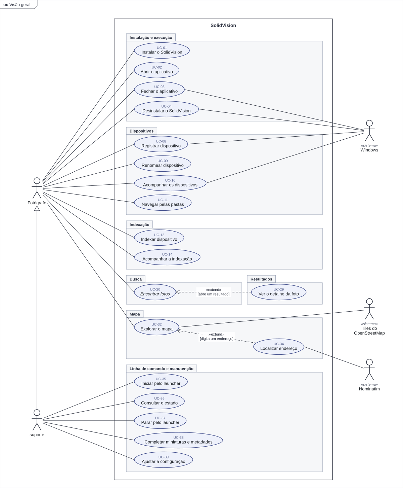
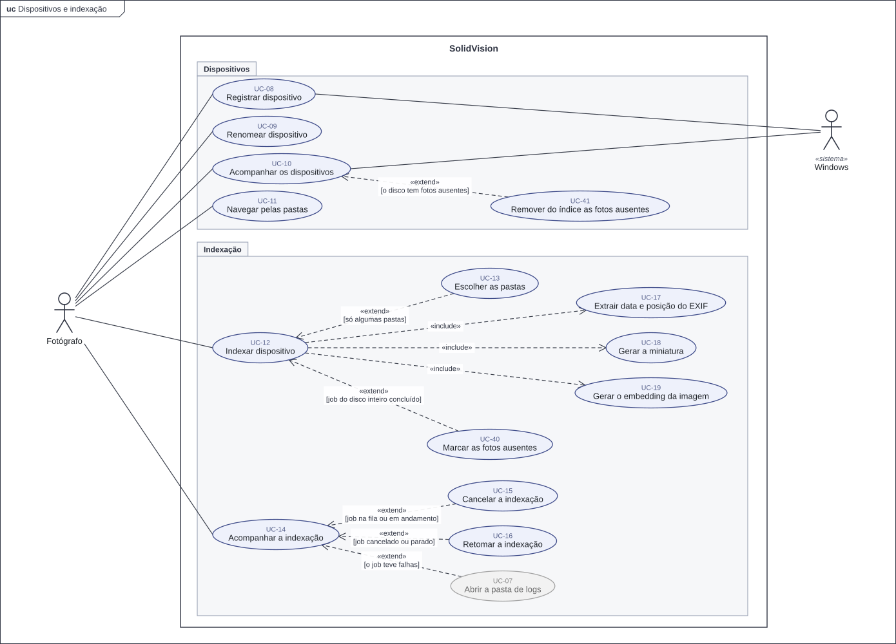
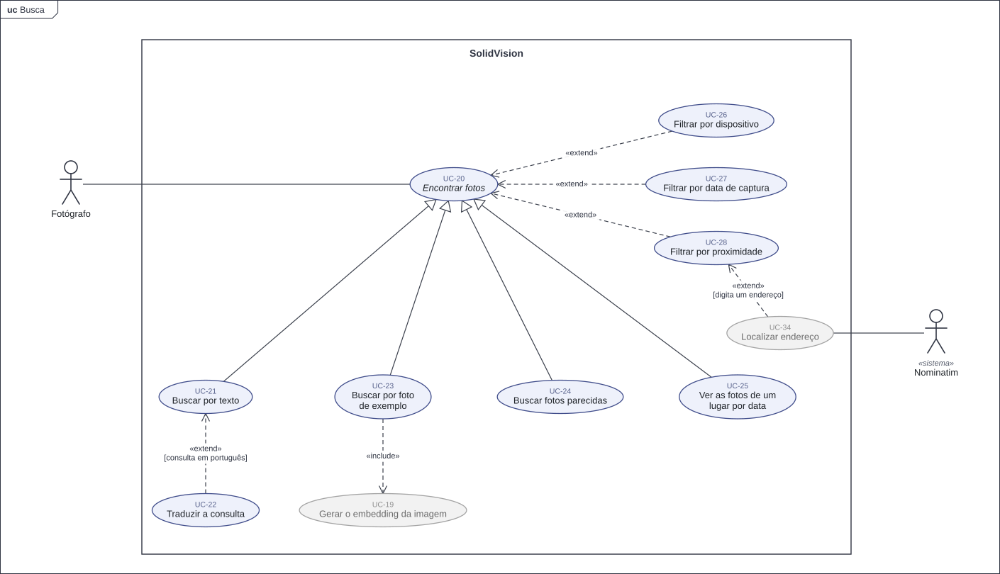
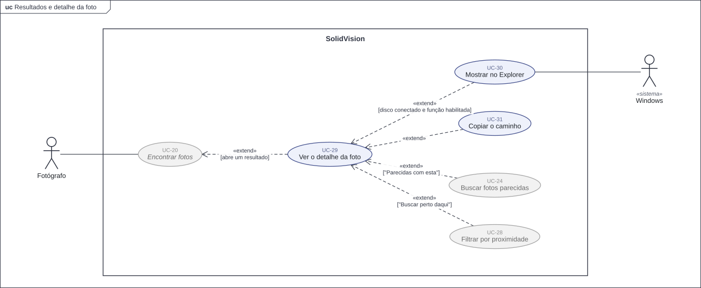
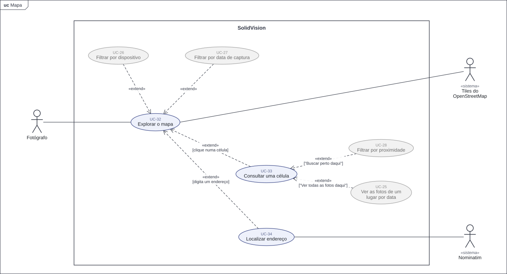
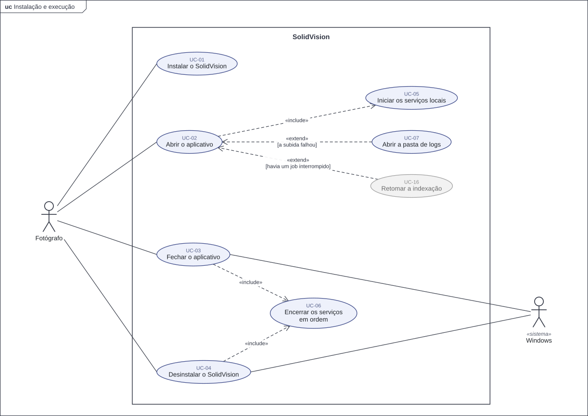
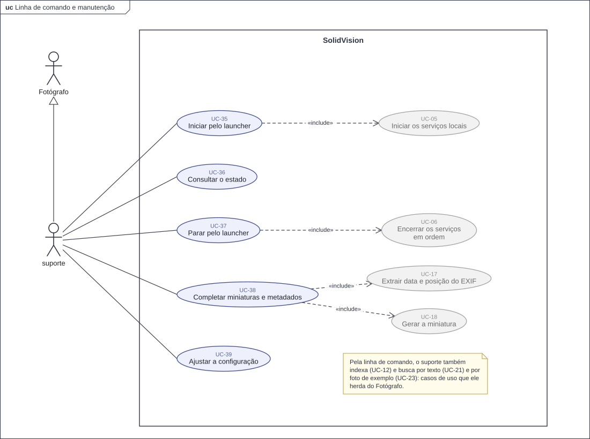

# SolidVision — Casos de uso

Situação em 05/11/2026. Diagramas UML de casos de uso do sistema, levantados dos [requisitos funcionais](requisitos.md) RF-01 a RF-72. Cada caso de uso cita os requisitos que cobre, e a [rastreabilidade](#6-rastreabilidade) mostra que todo requisito funcional tem pelo menos um caso de uso.

Os diagramas e as tabelas das seções 2, 5 e 6 são gerados de um modelo só, em [scripts/use_case_diagrams.py](../scripts/use_case_diagrams.py). Para mudar um caso de uso, mude o modelo e rode o script ([§8](#8-como-regenerar)); este texto, fora das tabelas, é editado à mão.

---

## 1. Visão geral do modelo

| | Quantidade |
|---|---|
| Atores | 5: dois primários (pessoas) e três secundários (sistemas externos) |
| Casos de uso | 41, em 7 pacotes |
| Diagramas | 7: uma visão geral e um por pacote, com Resultados à parte da Busca |
| Requisitos cobertos | RF-01 a RF-72, todos |

Os pacotes seguem os grupos de requisitos e a ordem de uso do app: instalar e abrir, registrar os discos, indexá-los, buscar, ver o resultado, explorar o mapa e, por fim, a manutenção pela linha de comando.

Os números não mudam: um caso de uso novo recebe o próximo número livre e entra no pacote do assunto dele, como UC-40 e UC-41, do RFC-046, que estão em Indexação e em Dispositivos.

## 2. Atores

<!-- BEGIN GENERATED: atores -->
| Ator | Tipo | Papel |
|---|---|---|
| Fotógrafo | Primário, pessoa | O dono do acervo, que usa o app pela interface gráfica, na própria máquina. É o único usuário: não há contas nem perfis. |
| suporte | Primário, pessoa | Quem usa a linha de comando e o arquivo de configuração. Especializa o Fotógrafo: faz tudo o que ele faz, e mais a manutenção. |
| Windows | Secundário, sistema externo | O sistema operacional. Informa os volumes montados e a conexão e a desconexão de um disco, abre o Explorer, encerra a sessão (logoff) e executa a desinstalação. |
| Tiles do OpenStreetMap | Secundário, sistema externo | O servidor das imagens do mapa. Dá o fundo do mapa quando há rede e o fotógrafo não o desligou. |
| Nominatim | Secundário, sistema externo | O serviço de endereços do OpenStreetMap. Converte o endereço digitado numa coordenada, só quando o fotógrafo pede. |
<!-- END GENERATED: atores -->

**O Fotógrafo e o Mantenedor são papéis, e não pessoas.** O sistema tem um único usuário, sem contas nem perfis ([§1](requisitos.md#1-contexto) e [§7](requisitos.md#7-fora-do-escopo-e-limitações-conhecidas) dos requisitos), e na prática os dois papéis costumam ser a mesma pessoa. Eles aparecem separados porque usam interfaces diferentes: a janela, de um lado; a linha de comando e o arquivo de configuração, do outro. O Mantenedor especializa o Fotógrafo (a seta de generalização entre os dois): herda todos os casos de uso dele e acrescenta os de manutenção.

**Os sistemas externos são secundários.** Nenhum deles inicia um caso de uso, salvo o Windows no logoff (UC-03). O OpenStreetMap e o Nominatim são o único tráfego que sai da máquina, e os dois são opcionais (RNF-19).

## 3. Como ler os diagramas

| Elemento | Significado |
|---|---|
| Boneco | Ator. Com «sistema» acima do nome, um sistema externo |
| Retângulo *SolidVision* | O limite do sistema: o que está dentro é o que o sistema faz |
| Pasta | Pacote: um grupo de casos de uso |
| Elipse | Caso de uso, com o número dele no [catálogo](#5-catálogo-dos-casos-de-uso) |
| Elipse com o nome em itálico | Caso de uso abstrato: só acontece por uma das especializações |
| Elipse cinza | Caso de uso de outro pacote, detalhado no diagrama dele, que aparece para mostrar a ligação |
| Linha contínua | Associação: o ator participa do caso de uso |
| Seta tracejada «include» | O caso base sempre executa o incluído. A seta aponta para o incluído |
| Seta tracejada «extend» [condição] | O caso que estende acrescenta um comportamento ao caso base, só quando a condição vale. A seta aponta para o base |
| Seta contínua com triângulo vazado | Generalização: o filho é um tipo do pai e herda as associações dele |
| Retângulo com o canto dobrado | Nota |

Cada diagrama está no quadro UML, com o rótulo `uc` e o nome no canto. Os SVGs abrem no navegador e entram no Word como imagem; para PNG, ver [§8](#8-como-regenerar).

## 4. Diagramas

### 4.1 Visão geral



Os casos de uso que os atores iniciam, por pacote. Os incluídos e quase todas as extensões ficam nos diagramas dos pacotes; aparecem aqui só as duas extensões que ligam um pacote a outro: o detalhe da foto (UC-29), que se abre a partir de um resultado, e o endereço (UC-34), que leva o mapa até um lugar.

### 4.2 Dispositivos e indexação



Registrar um disco e indexá-lo são casos separados: um disco registrado e nunca indexado é um estado normal, que a tela inicial aponta (UC-10). A indexação inclui a extração do EXIF, a miniatura e o embedding, que também servem à manutenção (UC-38) e à busca por foto de exemplo (UC-23). O cancelamento e a retomada estendem o acompanhamento do job, que é onde a interface os oferece.

As fotos que saíram do disco deixam o índice em dois passos, e o primeiro nunca apaga. O job do disco inteiro, ao terminar, marca as que não encontrou (UC-40), o que já as tira da busca e do mapa, e desmarca as que voltaram. Só o botão do cartão do disco as remove do índice (UC-41), que por isso estende o acompanhamento dos dispositivos, e não a indexação.

### 4.3 Busca



*Encontrar fotos* (UC-20) é abstrato: reúne o que as quatro formas de busca têm em comum, a grade de resultados e os filtros. Os filtros estendem o caso abstrato e, por herança, valem para as quatro (RF-40). Só a busca por texto e a por foto de exemplo usam o modelo de IA; as fotos parecidas usam o embedding já guardado, e a listagem de um lugar por data não usa embedding nenhum, por isso funcionam com a busca indisponível.

### 4.4 Resultados e detalhe da foto



O detalhe da foto é o ponto de partida de quatro ações. Duas são deste pacote, *Mostrar no Explorer* e *Copiar o caminho*; as outras duas voltam à busca, com a própria foto como exemplo (UC-24) ou como centro do círculo (UC-28).

### 4.5 Mapa



O mapa usa os filtros de dispositivo e de data, mas não o texto da busca (RF-47). O balão de uma célula leva de volta à busca, pelo círculo (UC-28) ou pela listagem por data (UC-25).

### 4.6 Instalação e execução



Abrir o app inclui subir os serviços locais (o banco embarcado, a API e o executor de jobs); fechar e desinstalar incluem pará-los em ordem. São os mesmos dois casos que o launcher executa pela linha de comando (UC-35 e UC-37).

### 4.7 Linha de comando e manutenção



Os casos de uso só do Mantenedor. A indexação e as buscas pela linha de comando (RF-65) não aparecem como casos próprios: são os mesmos casos de uso da interface, que o Mantenedor herda do Fotógrafo, por outra interface.

## 5. Catálogo dos casos de uso

A coluna *Relações* usa os mesmos termos dos diagramas; entre colchetes, a condição de cada extensão. *Os do caso base* quer dizer que o caso de uso não tem ator próprio: ele acontece dentro de outro, que o inclui ou que ele estende.

<!-- BEGIN GENERATED: catalogo -->
### Instalação e execução

| ID | Caso de uso | Atores | Descrição | Relações | Requisitos |
|---|---|---|---|---|---|
| UC-01 | Instalar o SolidVision | Fotógrafo | Instala o programa na conta do usuário, sem pedir administrador, com o Python, o PostgreSQL e os modelos de IA; cria os atalhos e abre o app ao terminar. | — | RF-61 |
| UC-02 | Abrir o aplicativo | Fotógrafo | Abre a janela, mostra as fases da subida e chega à tela inicial. Abrir de novo traz a janela existente para a frente; se a API reinicia, a janela mostra *Reconectando…* e volta sozinha. A interface só oferece o que a instalação suporta. | Inclui UC-05; estendido por UC-07, UC-16. | RF-54, RF-55, RF-57, RF-64 |
| UC-03 | Fechar o aplicativo | Fotógrafo, Windows | Fecha a janela e para tudo em ordem; com um job em andamento, avisa antes que a indexação pausa e continua na próxima abertura. O logoff do Windows faz a mesma parada. | Inclui UC-06. | RF-59, RF-60 |
| UC-04 | Desinstalar o SolidVision | Fotógrafo, Windows | Remove o programa e os atalhos por *Configurações > Aplicativos*, com o app aberto ou fechado, e preserva os dados: reinstalar reaproveita o acervo indexado. | Inclui UC-06. | RF-62 |
| UC-05 | Iniciar os serviços locais | Os do caso base | Sobe o banco embarcado, aplica as migrations e sobe a API e o executor de jobs. Supervisiona os três e reinicia o que morrer, com espera crescente e um limite de tentativas. | Incluído por UC-02, UC-35. | RF-54, RF-58 |
| UC-06 | Encerrar os serviços em ordem | Os do caso base | Para a API e o executor de jobs, e depois o banco, sem deixar processo para trás. Um job em andamento fica com o ponto de retomada. | Incluído por UC-03, UC-04, UC-37. | RF-59, RF-62 |
| UC-07 | Abrir a pasta de logs | Os do caso base | Abre no Explorer a pasta de logs, oferecida pela tela de erro da subida, que mostra a causa, e pelo painel de um job que teve falhas. | Estende UC-02 [a subida falhou], UC-14 [o job teve falhas]. | RF-56 |

### Dispositivos

| ID | Caso de uso | Atores | Descrição | Relações | Requisitos |
|---|---|---|---|---|---|
| UC-08 | Registrar dispositivo | Fotógrafo, Windows | Escolhe um dos volumes montados que o Windows informa e o registra com um rótulo único, como *HD2*. O registro usa a identidade do volume, e não a letra da unidade; registrar o mesmo volume de novo devolve o mesmo dispositivo. | — | RF-01, RF-02, RF-03 |
| UC-09 | Renomear dispositivo | Fotógrafo | Troca o rótulo de um dispositivo, o único campo editável. | — | RF-04 |
| UC-10 | Acompanhar os dispositivos | Fotógrafo, Windows | Mostra, para cada dispositivo, o rótulo, a conexão, as fotos indexadas, o percentual com a data do scan, o job ativo e quantas fotos o último scan não encontrou; na tela inicial, o resumo do acervo e o aviso dos discos nunca indexados. A conexão e a desconexão aparecem pela mensagem de volume do Windows, e um disco com outra letra continua reconhecido. | Estendido por UC-41. | RF-05, RF-06, RF-07, RF-08, RF-11, RF-35, RF-69, RF-72 |
| UC-11 | Navegar pelas pastas | Fotógrafo | Percorre as pastas de um disco conectado, um nível por vez, com o estado de indexação e as fotos indexadas de cada uma. Com o disco desconectado, pede para conectá-lo. | — | RF-09, RF-10 |
| UC-41 | Remover do índice as fotos ausentes | Os do caso base | Pelo botão *Remover do índice* do cartão, apaga do índice as fotos ausentes do disco e as miniaturas delas, depois de uma confirmação com o número de fotos. O botão fica desligado enquanto o disco tem um job. Não precisa do disco conectado, e não toca nele. | Estende UC-10 [o disco tem fotos ausentes]. | RF-69 |

### Indexação

| ID | Caso de uso | Atores | Descrição | Relações | Requisitos |
|---|---|---|---|---|---|
| UC-12 | Indexar dispositivo | Fotógrafo | Pede a indexação do disco, que roda em segundo plano, num job: no máximo um ativo por disco. Os arquivos sem mudança são pulados, e a lixeira, a `System Volume Information` e o cache de miniaturas ficam de fora. Sem o executor de jobs, a interface diz que a indexação está indisponível. Também pela linha de comando (`index`). | Inclui UC-17, UC-18, UC-19; estendido por UC-13, UC-40. | RF-12, RF-13, RF-14, RF-18, RF-19, RF-25, RF-26, RF-65, RF-71 |
| UC-13 | Escolher as pastas | Os do caso base | Restringe a indexação às pastas marcadas; a pasta mãe absorve as filhas. | Estende UC-12 [só algumas pastas]. | RF-12 |
| UC-14 | Acompanhar a indexação | Fotógrafo | Mostra o job do disco: na fila, lendo a lista de arquivos, ou os contadores de descobertos, processados, pulados e com falha e o último arquivo salvo. O job não exibe percentual. | Estendido por UC-07, UC-15, UC-16. | RF-15 |
| UC-15 | Cancelar a indexação | Os do caso base | Pede o fim do job. Um job na fila para na hora; um em andamento mostra *Cancelando…* até parar no próximo ponto salvo. | Estende UC-14 [job na fila ou em andamento]. | RF-16 |
| UC-16 | Retomar a indexação | Os do caso base | Continua um job interrompido do último ponto salvo, sem perder nem repetir fotos: pelo *Indexar de novo*, depois de um cancelamento ou de uma falha, ou sozinho, na abertura seguinte do app. | Estende UC-14 [job cancelado ou parado], UC-02 [havia um job interrompido]. | RF-17 |
| UC-17 | Extrair data e posição do EXIF | Os do caso base | Lê do EXIF a data de captura e a posição GPS e registra de onde vieram. Distingue a foto que não tem o dado da que nunca foi examinada. | Incluído por UC-12, UC-38. | RF-21, RF-22, RF-23 |
| UC-18 | Gerar a miniatura | Os do caso base | Gera a miniatura de 512 px no cache do app, sem escrever no disco do acervo. | Incluído por UC-12, UC-38. | RF-24 |
| UC-19 | Gerar o embedding da imagem | Os do caso base | Converte a imagem num vetor de 512 dimensões com o CLIP, em lotes. | Incluído por UC-12, UC-23. | RF-20 |
| UC-40 | Marcar as fotos ausentes | Os do caso base | Ao fim do job, compara as fotos indexadas do disco com a lista de arquivos que o job leu: marca as que não estão mais lá, que saem da busca, e desmarca as que voltaram, sem gerar o embedding de novo. Nada é marcado se o disco saiu ou mudou de letra durante o job, nem dentro de uma pasta que não pôde ser lida. | Estende UC-12 [job do disco inteiro concluído]. | RF-70 |

### Busca

| ID | Caso de uso | Atores | Descrição | Relações | Requisitos |
|---|---|---|---|---|---|
| UC-20 | *Encontrar fotos* (abstrato) | Fotógrafo | O que as quatro formas de encontrar fotos têm em comum: a grade de resultados, 40 por vez e *Mostrar mais*, com a miniatura, o dispositivo, o nome e a similaridade, mesmo com o disco desconectado; e os filtros, que se combinam. As fotos marcadas como ausentes (UC-40) não aparecem. Abstrato: só existe pelas especializações. | Estendido por UC-26, UC-27, UC-28, UC-29; especializado por UC-21, UC-23, UC-24, UC-25. | RF-28, RF-29, RF-40, RF-41, RF-42, RF-72 |
| UC-21 | Buscar por texto | Herdados de UC-20 | Busca por uma descrição em português ou em inglês, ao pressionar Enter; recusa a consulta vazia. Mostra o estado do modelo enquanto ele carrega e oferece consultas de exemplo. Também pela linha de comando (`search`). | Especializa UC-20; estendido por UC-22. | RF-27, RF-30, RF-33, RF-34, RF-35, RF-65 |
| UC-22 | Traduzir a consulta | Os do caso base | Traduz a consulta para o inglês antes de ela chegar ao modelo. | Estende UC-21 [consulta em português]. | RF-27 |
| UC-23 | Buscar por foto de exemplo | Herdados de UC-20 | Busca as fotos parecidas com uma imagem solta na barra de busca (JPEG ou PNG, até 50 MB), que não é guardada. Também pela linha de comando (`search-image`). | Inclui UC-19; especializa UC-20. | RF-32, RF-34, RF-65 |
| UC-24 | Buscar fotos parecidas | Herdados de UC-20 | Busca as fotos parecidas com uma foto já indexada, pelo embedding guardado: funciona sem o modelo e com o disco desconectado. | Estende UC-29 ["Parecidas com esta"]; especializa UC-20. | RF-31 |
| UC-25 | Ver as fotos de um lugar por data | Herdados de UC-20 | Lista todas as fotos de um círculo pela data de captura, sem consulta e sem o modelo: as mais recentes primeiro, ou as mais antigas, e as sem data no fim. | Estende UC-33 ["Ver todas as fotos daqui"]; especializa UC-20. | RF-53 |
| UC-26 | Filtrar por dispositivo | Os do caso base | Restringe as fotos a um ou mais dispositivos. | Estende UC-20, UC-32. | RF-36, RF-40, RF-47 |
| UC-27 | Filtrar por data de captura | Os do caso base | Restringe as fotos a um intervalo de datas de captura e diz quantas ficaram de fora por não terem data. | Estende UC-20, UC-32. | RF-37, RF-40, RF-47 |
| UC-28 | Filtrar por proximidade | Os do caso base | Restringe as fotos a um círculo, de 300 m a 100 km, com o centro numa foto, num ponto do mapa, em coordenadas ou num endereço, e diz quantas ficaram de fora por não terem posição. | Estende UC-20, UC-29 ["Buscar perto daqui"], UC-33 ["Buscar perto daqui"]; estendido por UC-34. | RF-38, RF-39, RF-40 |

### Resultados

| ID | Caso de uso | Atores | Descrição | Relações | Requisitos |
|---|---|---|---|---|---|
| UC-29 | Ver o detalhe da foto | Os do caso base | Mostra a miniatura, a data e a posição com as origens, o dispositivo e o caminho. Com o disco desconectado, diz onde a foto está, sem erro. | Estende UC-20 [abre um resultado]; estendido por UC-24, UC-28, UC-30, UC-31. | RF-42, RF-43 |
| UC-30 | Mostrar no Explorer | Windows, mais os do caso base | Abre o Explorer com a foto selecionada. Se o disco não está conectado, ou o arquivo não está mais nele, diz qual dos dois. | Estende UC-29 [disco conectado e função habilitada]. | RF-44, RF-64 |
| UC-31 | Copiar o caminho | Os do caso base | Copia o caminho da foto para a área de transferência. | Estende UC-29. | RF-45 |

### Mapa

| ID | Caso de uso | Atores | Descrição | Relações | Requisitos |
|---|---|---|---|---|---|
| UC-32 | Explorar o mapa | Fotógrafo, Tiles do OpenStreetMap | Mostra quantas fotos há em cada célula da área visível, numa precisão que acompanha o zoom, com a legenda, as 20 células mais cheias e o aviso das fotos sem posição; as marcadas como ausentes não entram nas contagens. O fundo vem dos tiles do OpenStreetMap ou, sem rede, do contorno dos estados. | Estendido por UC-26, UC-27, UC-33, UC-34. | RF-46, RF-47, RF-48, RF-50, RF-51, RF-72 |
| UC-33 | Consultar uma célula | Os do caso base | Abre o balão de uma célula, com a contagem e as ações *Buscar perto daqui*, *Aproximar* e *Ver todas as fotos daqui, por data*. | Estende UC-32 [clique numa célula]; estendido por UC-25, UC-28. | RF-49 |
| UC-34 | Localizar endereço | Nominatim, mais os do caso base | Envia o endereço digitado ao Nominatim e leva até ele o mapa, ou o centro do *Perto de*, com o nome do lugar encontrado. Só quando o fotógrafo pede, e pode ser desligado na configuração. | Estende UC-32 [digita um endereço], UC-28 [digita um endereço]. | RF-52, RF-64 |

### Linha de comando e manutenção

| ID | Caso de uso | Atores | Descrição | Relações | Requisitos |
|---|---|---|---|---|---|
| UC-35 | Iniciar pelo launcher | suporte | Sobe tudo pela linha de comando, sem a janela. | Inclui UC-05. | RF-66 |
| UC-36 | Consultar o estado | suporte | Mostra o que está de pé e onde (`status`), e o estado da busca, pela rota de saúde, que consulta o banco de verdade. | — | RF-66, RF-68 |
| UC-37 | Parar pelo launcher | suporte | Para tudo pela linha de comando (`stop`). | Inclui UC-06. | RF-66 |
| UC-38 | Completar miniaturas e metadados | suporte | Completa, sem carregar o modelo, as miniaturas e a data e a posição das fotos indexadas antes dessas funções existirem, com `--force` e `--dry-run`. | Inclui UC-17, UC-18. | RF-67 |
| UC-39 | Ajustar a configuração | suporte | Edita o arquivo opcional `solidvision.env`, com as chaves do `.env.example`. A interface passa a oferecer só o que a configuração habilita. | — | RF-63, RF-64 |
<!-- END GENERATED: catalogo -->

## 6. Rastreabilidade

Cada requisito funcional e os casos de uso que o cobrem. Um requisito pode estar em mais de um caso de uso, como os filtros (RF-40), que valem para todas as buscas e para o mapa.

<!-- BEGIN GENERATED: rastreabilidade -->
| Requisito | Grupo | Casos de uso |
|---|---|---|
| [RF-01](requisitos.md#31-dispositivos) | Dispositivos | UC-08 |
| [RF-02](requisitos.md#31-dispositivos) | Dispositivos | UC-08 |
| [RF-03](requisitos.md#31-dispositivos) | Dispositivos | UC-08 |
| [RF-04](requisitos.md#31-dispositivos) | Dispositivos | UC-09 |
| [RF-05](requisitos.md#31-dispositivos) | Dispositivos | UC-10 |
| [RF-06](requisitos.md#31-dispositivos) | Dispositivos | UC-10 |
| [RF-07](requisitos.md#31-dispositivos) | Dispositivos | UC-10 |
| [RF-08](requisitos.md#31-dispositivos) | Dispositivos | UC-10 |
| [RF-09](requisitos.md#31-dispositivos) | Dispositivos | UC-11 |
| [RF-10](requisitos.md#31-dispositivos) | Dispositivos | UC-11 |
| [RF-11](requisitos.md#31-dispositivos) | Dispositivos | UC-10 |
| [RF-69](requisitos.md#31-dispositivos) | Dispositivos | UC-10, UC-41 |
| [RF-12](requisitos.md#32-indexação) | Indexação | UC-12, UC-13 |
| [RF-13](requisitos.md#32-indexação) | Indexação | UC-12 |
| [RF-14](requisitos.md#32-indexação) | Indexação | UC-12 |
| [RF-15](requisitos.md#32-indexação) | Indexação | UC-14 |
| [RF-16](requisitos.md#32-indexação) | Indexação | UC-15 |
| [RF-17](requisitos.md#32-indexação) | Indexação | UC-16 |
| [RF-18](requisitos.md#32-indexação) | Indexação | UC-12 |
| [RF-19](requisitos.md#32-indexação) | Indexação | UC-12 |
| [RF-20](requisitos.md#32-indexação) | Indexação | UC-19 |
| [RF-21](requisitos.md#32-indexação) | Indexação | UC-17 |
| [RF-22](requisitos.md#32-indexação) | Indexação | UC-17 |
| [RF-23](requisitos.md#32-indexação) | Indexação | UC-17 |
| [RF-24](requisitos.md#32-indexação) | Indexação | UC-18 |
| [RF-25](requisitos.md#32-indexação) | Indexação | UC-12 |
| [RF-26](requisitos.md#32-indexação) | Indexação | UC-12 |
| [RF-70](requisitos.md#32-indexação) | Indexação | UC-40 |
| [RF-71](requisitos.md#32-indexação) | Indexação | UC-12 |
| [RF-27](requisitos.md#33-busca) | Busca | UC-21, UC-22 |
| [RF-28](requisitos.md#33-busca) | Busca | UC-20 |
| [RF-29](requisitos.md#33-busca) | Busca | UC-20 |
| [RF-30](requisitos.md#33-busca) | Busca | UC-21 |
| [RF-31](requisitos.md#33-busca) | Busca | UC-24 |
| [RF-32](requisitos.md#33-busca) | Busca | UC-23 |
| [RF-33](requisitos.md#33-busca) | Busca | UC-21 |
| [RF-34](requisitos.md#33-busca) | Busca | UC-21, UC-23 |
| [RF-35](requisitos.md#33-busca) | Busca | UC-10, UC-21 |
| [RF-72](requisitos.md#33-busca) | Busca | UC-10, UC-20, UC-32 |
| [RF-36](requisitos.md#34-filtros) | Filtros | UC-26 |
| [RF-37](requisitos.md#34-filtros) | Filtros | UC-27 |
| [RF-38](requisitos.md#34-filtros) | Filtros | UC-28 |
| [RF-39](requisitos.md#34-filtros) | Filtros | UC-28 |
| [RF-40](requisitos.md#34-filtros) | Filtros | UC-20, UC-26, UC-27, UC-28 |
| [RF-41](requisitos.md#35-resultados-e-detalhe-da-foto) | Resultados e detalhe da foto | UC-20 |
| [RF-42](requisitos.md#35-resultados-e-detalhe-da-foto) | Resultados e detalhe da foto | UC-20, UC-29 |
| [RF-43](requisitos.md#35-resultados-e-detalhe-da-foto) | Resultados e detalhe da foto | UC-29 |
| [RF-44](requisitos.md#35-resultados-e-detalhe-da-foto) | Resultados e detalhe da foto | UC-30 |
| [RF-45](requisitos.md#35-resultados-e-detalhe-da-foto) | Resultados e detalhe da foto | UC-31 |
| [RF-46](requisitos.md#36-mapa-e-lugares) | Mapa e lugares | UC-32 |
| [RF-47](requisitos.md#36-mapa-e-lugares) | Mapa e lugares | UC-26, UC-27, UC-32 |
| [RF-48](requisitos.md#36-mapa-e-lugares) | Mapa e lugares | UC-32 |
| [RF-49](requisitos.md#36-mapa-e-lugares) | Mapa e lugares | UC-33 |
| [RF-50](requisitos.md#36-mapa-e-lugares) | Mapa e lugares | UC-32 |
| [RF-51](requisitos.md#36-mapa-e-lugares) | Mapa e lugares | UC-32 |
| [RF-52](requisitos.md#36-mapa-e-lugares) | Mapa e lugares | UC-34 |
| [RF-53](requisitos.md#36-mapa-e-lugares) | Mapa e lugares | UC-25 |
| [RF-54](requisitos.md#37-abrir-acompanhar-e-fechar-o-app) | Abrir, acompanhar e fechar o app | UC-02, UC-05 |
| [RF-55](requisitos.md#37-abrir-acompanhar-e-fechar-o-app) | Abrir, acompanhar e fechar o app | UC-02 |
| [RF-56](requisitos.md#37-abrir-acompanhar-e-fechar-o-app) | Abrir, acompanhar e fechar o app | UC-07 |
| [RF-57](requisitos.md#37-abrir-acompanhar-e-fechar-o-app) | Abrir, acompanhar e fechar o app | UC-02 |
| [RF-58](requisitos.md#37-abrir-acompanhar-e-fechar-o-app) | Abrir, acompanhar e fechar o app | UC-05 |
| [RF-59](requisitos.md#37-abrir-acompanhar-e-fechar-o-app) | Abrir, acompanhar e fechar o app | UC-03, UC-06 |
| [RF-60](requisitos.md#37-abrir-acompanhar-e-fechar-o-app) | Abrir, acompanhar e fechar o app | UC-03 |
| [RF-61](requisitos.md#38-instalação-e-configuração) | Instalação e configuração | UC-01 |
| [RF-62](requisitos.md#38-instalação-e-configuração) | Instalação e configuração | UC-04, UC-06 |
| [RF-63](requisitos.md#38-instalação-e-configuração) | Instalação e configuração | UC-39 |
| [RF-64](requisitos.md#38-instalação-e-configuração) | Instalação e configuração | UC-02, UC-30, UC-34, UC-39 |
| [RF-65](requisitos.md#39-linha-de-comando-e-manutenção) | Linha de comando e manutenção | UC-12, UC-21, UC-23 |
| [RF-66](requisitos.md#39-linha-de-comando-e-manutenção) | Linha de comando e manutenção | UC-35, UC-36, UC-37 |
| [RF-67](requisitos.md#39-linha-de-comando-e-manutenção) | Linha de comando e manutenção | UC-38 |
| [RF-68](requisitos.md#39-linha-de-comando-e-manutenção) | Linha de comando e manutenção | UC-36 |
<!-- END GENERATED: rastreabilidade -->

## 7. O que não é caso de uso

- **Comportamentos internos sem ator próprio**, como a supervisão dos processos (RF-58) e o executor de jobs (RF-13), estão dentro do caso de uso em que acontecem (UC-05 e UC-12), e não em casos próprios.
- **Os requisitos não funcionais** (RNF-01 a RNF-73) e as restrições técnicas (RT-01 a RT-10) não viram casos de uso: eles dizem com que qualidade os casos de uso acontecem. Estão em [requisitos.md](requisitos.md).
- **O que ficou fora do escopo** (apagar um dispositivo, monitorar pastas, histórico de buscas, vários usuários e o resto da [§7 dos requisitos](requisitos.md#7-fora-do-escopo-e-limitações-conhecidas)) não tem caso de uso.

## 8. Como regenerar

```powershell
python scripts/use_case_diagrams.py              # reescreve os SVGs e as tabelas
python scripts/use_case_diagrams.py --check      # sai com 1 se algo estiver desatualizado
python scripts/use_case_diagrams.py --png pasta  # também gera PNGs, com o Edge
```

O script só usa a biblioteca padrão do Python. Ele também confere o modelo contra [requisitos.md](requisitos.md): falha se um requisito funcional ficar sem caso de uso, ou se um caso de uso citar um requisito que não existe. Os PNGs saem no dobro do tamanho do SVG, para impressão, e não são versionados.
